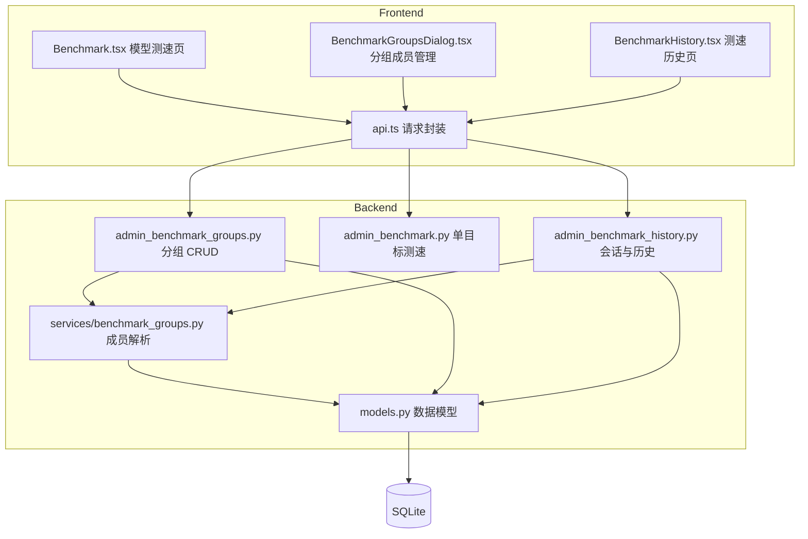
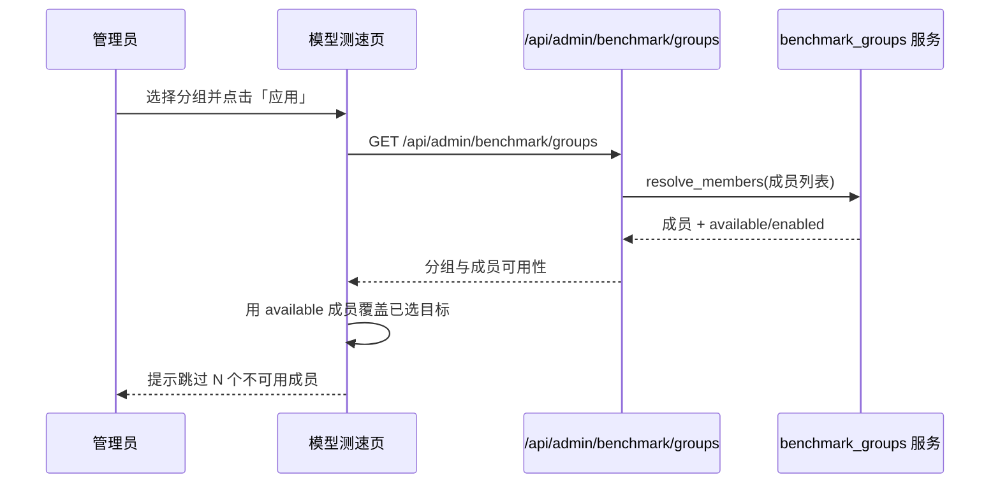
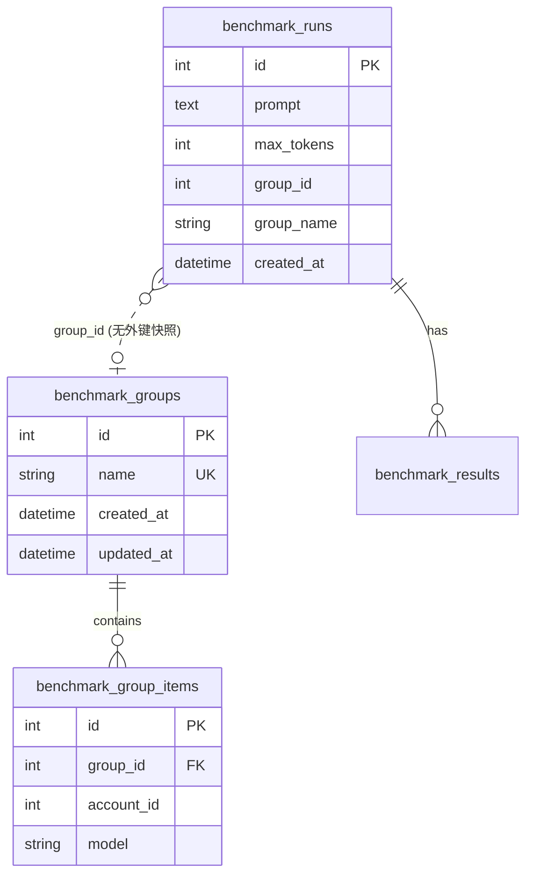

# 测速分组 (benchmark-groups)

Feature Name: benchmark-groups
Updated: 2026-10-09

## Description

为模型测速引入「测速分组」：管理员可把一组「账号 × 模型」测速目标命名保存到后端，在模型测速页一键套用，从而免去每次逐个勾选。分组为静态名单（保存具体账号与模型），全部管理员共享；分组随账号/模型的增删停用自动标记成员可用性。测速会话在保存时记录所属分组，测速历史支持按分组筛选。

对应需求：`.monkeycode/specs/2026-10-09-benchmark-groups/requirements.md`。

## Architecture

### 组件关系

### 套用分组时序

## Components and Interfaces

### 后端

#### 数据模型 (`backend/app/models.py`)

新增两张表，并在 `BenchmarkRun` 上增加归属快照列：

- `BenchmarkGroup`（`benchmark_groups`）：`id`、`name`（`String(128)`，trim 后唯一）、`created_at`、`updated_at`、`items` 关系（`cascade="all, delete-orphan"`）。
- `BenchmarkGroupItem`（`benchmark_group_items`）：`id`、`group_id`（FK `benchmark_groups.id` `ondelete="CASCADE"`，index）、`account_id`（`Integer`）、`model`（`String(128)`），`UniqueConstraint("group_id", "account_id", "model")`。`account_id` 不设外键，保证账号删除后成员记录仍在（需求 4）。
- `BenchmarkRun` 新增：`group_id`（`Integer`，nullable，无外键，删除分组不阻断）、`group_name`（`String(128)`，nullable，保存时快照分组名，分组删除后历史仍可显示）。

建表由 `init_db()` 的 `Base.metadata.create_all` 完成；`benchmark_runs` 的新列在 `_ensure_columns` 中以 `PRAGMA table_info` + `ALTER TABLE` 增量补齐（沿用现有迁移风格）。

#### 成员解析服务 (`backend/app/services/benchmark_groups.py`)

- `normalize_name(name: str) -> str`：`strip()`。
- `resolve_members(db, items) -> list[dict]`：批量加载相关 `UpstreamAccount`，用 `parse_model_records` 建立每个账号的「存在且 enabled」模型集合；返回每项 `{account_id, model, account_name, provider, available, enabled, reason}`。`available` 判定为：账号存在、`account.status == "active"`、模型在账号模型清单中、且该模型 `enabled`。账号不存在 → `available=False, reason="账号不存在"`；模型缺失或停用 → 对应原因。
- `group_to_dict(db, group) -> dict`：输出分组基础字段 + `members`（`resolve_members` 结果）+ `member_count` + `available_count`。

#### 分组接口 (`backend/app/routers/admin_benchmark_groups.py`)

`APIRouter(prefix="/api/admin/benchmark/groups", tags=["admin-benchmark-groups"], dependencies=[Depends(get_current_admin)])`，与 `admin_benchmark.py` 一致使用内联 Pydantic 模型。

| 方法 | 路径 | 请求体 | 响应 | 说明 |
|------|------|--------|------|------|
| GET | `""` | — | `{"items": [GroupOut]}` | 列出全部分组（含已解析成员），按 `updated_at` 倒序 |
| POST | `""` | `GroupCreate{name, targets[]}` | `GroupOut`（201） | 创建分组 |
| PATCH | `/{group_id}` | `GroupUpdate{name?, targets?}` | `GroupOut` | 重命名与/或整体替换成员 |
| DELETE | `/{group_id}` | — | `{"removed": true}` | 删除分组，保留历史会话 |

- `GroupTargetInput{account_id: int, model: str}`；`GroupCreate{name: str, targets: list >= 1}`；`GroupUpdate{name: str | None, targets: list | None}`。
- `targets` 为整体替换语义（需求 3.2）：`PATCH` 携带 `targets` 时删除旧成员并按新列表重建。
- 名称唯一性：`normalize_name` 后非空，按大小写不敏感比较；重名返回 409，空名返回 400（需求 1.2/1.3）。
- `targets` 中的账号必须存在，否则 400；模型允许暂不存在（后续标记不可用）。

#### 历史接口改造 (`backend/app/routers/admin_benchmark_history.py`)

- `SaveBenchmarkRequest` 增加 `group_id: int | None = None`；`save_benchmark` 在 `group_id` 存在时加载分组，写入 `run.group_id` 与 `run.group_name = group.name` 快照；`group_id` 指向不存在的分组返回 400。
- `run_to_dict` / `run_summary_to_dict` 增加 `group_id`、`group_name`。
- `list_benchmark_runs` 增加查询参数 `group_id: int | None = Query(default=None)`，非空时用 `WHERE BenchmarkRun.group_id == group_id` 过滤（需求 6.2）。

#### 路由注册 (`backend/app/main.py`)

在 `admin_benchmark_history` 之后新增 `app.include_router(admin_benchmark_groups.router)`，并在文件顶部 import 列表加入 `admin_benchmark_groups`（避免与 `/api/admin/benchmark/history` 的 `/{run_id}` 路由混淆，`groups` 使用独立前缀）。

### 前端

#### `frontend/src/lib/api.ts`

- 类型：`BenchmarkGroupMember`、`BenchmarkGroup`、`BenchmarkHistory` 增加 `group_id`/`group_name`（在 `BenchmarkRun` 上）。
- 方法：`benchmarkGroups()`、`createBenchmarkGroup(payload)`、`updateBenchmarkGroup(id, payload)`、`deleteBenchmarkGroup(id)`；`benchmarkHistory(page, pageSize, groupId?)` 追加 `group_id` 查询参数；`saveBenchmarkRun` 负载增加 `group_id`。

#### `frontend/src/pages/Benchmark.tsx`

- 测试配置区新增「测速分组」工具条：分组 `Select` + 「应用」按钮 + 「管理分组」按钮 + 「保存为分组」按钮。
- 状态：新增 `activeGroupId`、`groupDialogOpen`、`groupNameDraft`。
- 「应用」：调用分组数据，用 `available` 成员生成 `keyOf` 集合并整体覆盖 `selected`；有跳过成员时用 `notifyBad`/提示跳过数量（需求 2.1/2.2/4.2）。
- 「保存为分组」：以当前 `selectedTargets` 为 `targets` 创建工作分组；「更新分组」在 `activeGroupId` 非空时以当前选择整体替换成员（需求 3.2）。
- 分组列表通过 React Query key `['benchmark-groups']` 缓存，增删改后 `invalidateQueries`。

#### `frontend/src/components/BenchmarkGroupsDialog.tsx`（新增）

- 展示分组列表：名称、成员数/可用数、更新时间；支持内联重命名、删除、展开查看成员可用性。
- 打开时以当前已选目标「另存为新分组」。
- 复用 `components/ui.tsx` 的 `Dialog/Button/Input/Field`，桌面与移动端自适应（沿用 `Benchmark.tsx` 的响应式类）。

#### `frontend/src/pages/BenchmarkHistory.tsx`

- 表格上方新增按分组 `Select` 过滤（含「全部分组」），切换后回到第 1 页并重新查询（需求 6.2）。
- 列表行与会话详情弹窗展示 `group_name`（需求 6.3）。

## Data Models

- `benchmark_groups.name`：唯一索引 `ix_benchmark_groups_name`（应用层做大小写不敏感校验，索引作为并发兜底）。
- `benchmark_group_items`：`UniqueConstraint(group_id, account_id, model)`；`ix_benchmark_group_items_group_id`。
- `benchmark_runs`：新增 `group_id`（index，用于历史筛选）、`group_name`。

## Correctness Properties

1. 任一时刻，同一分组名称（去空白、忽略大小写）在库中至多存在一条。
2. 分组成员在同一分组内 `(account_id, model)` 唯一。
3. 套用分组后的已选目标集合，等于该分组的全部 `available` 成员；不可用成员被跳过且被明确提示。
4. 读取分组时执行 `sync_members`：账号已删除、或模型已不在账号模型清单中的成员被移除（需求 4.1/4.2）；模型仍在清单但被关闭的成员保留（需求 4.3）。
5. 删除分组不删除任何 `BenchmarkRun`；已保存会话保留 `group_name` 快照（需求 5.4/8.3）。
6. 分组数据全局共享，任意管理员可见同一份列表（需求 6.1）。

## Error Handling

| 场景 | 状态码 | 行为 |
|------|--------|------|
| 创建/更新分组名称为空（trim 后） | 400 | 返回校验错误，不落库 |
| 分组名称重复（忽略大小写） | 409 | 保持已有分组不变 |
| 创建/更新 `targets` 为空 | 400 | 拒绝 |
| `targets` 含不存在的 `account_id` | 400 | 拒绝并指出账号 |
| `PATCH`/`DELETE` 的分组不存在 | 404 | 「分组不存在」 |
| 保存会话指定的 `group_id` 不存在 | 400 | 拒绝保存 |
| 套用分组无可用成员 | 200 + 前端提示 | 不修改已选，提示「该分组当前没有可用目标」 |

前端所有失败经 `errorMessage` 包装后用 `notifyBad` 提示；成功用 `notifyOk`。

## Test Strategy

### 后端 (`backend/tests/test_benchmark_groups.py`)

使用 `client` / `auth_headers` fixture，覆盖：

1. 创建分组后 `GET` 能查到，成员数与名称正确。
2. 空名称 400、重名 409、空 `targets` 400、账号不存在 400。
3. `PATCH` 重命名保留成员；`PATCH` 携带 `targets` 整体替换成员。
4. 成员可用性：账号停用、模型停用/删除时 `available=False` 且 `reason` 正确；恢复后 `available=True`。
5. `DELETE` 分组后分组消失，但历史会话仍在。
6. 保存会话带 `group_id` 时 `run` 记录 `group_id`/`group_name`；`group_id` 不存在返回 400。
7. `list_benchmark_runs?group_id=` 只返回该分组的会话。

### 前端

- `cd frontend && npx tsc -b` 与 `npm run lint` 通过。
- 手工核对桌面与移动端：分组工具条、管理弹窗、历史分组筛选与详情展示。

## References

[^1]: (backend/app/models.py#L225) - [BenchmarkRun / BenchmarkResult 定义](../backend/app/models.py)
[^2]: (backend/app/routers/admin_benchmark_history.py#L42) - [会话保存与历史接口](../backend/app/routers/admin_benchmark_history.py)
[^3]: (backend/app/routers/admin_benchmark.py#L26) - [测速目标接口前缀](../backend/app/routers/admin_benchmark.py)
[^4]: (backend/app/db.py#L47) - [init_db 建表与增量迁移](../backend/app/db.py)
[^5]: (frontend/src/pages/Benchmark.tsx#L76) - [模型测速页目标选择逻辑](../frontend/src/pages/Benchmark.tsx)
[^6]: (frontend/src/pages/BenchmarkHistory.tsx#L42) - [测速历史页](../frontend/src/pages/BenchmarkHistory.tsx)
