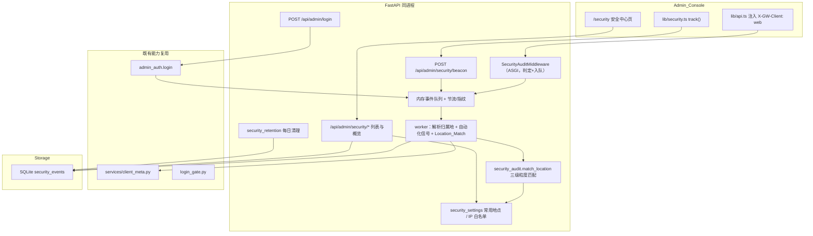
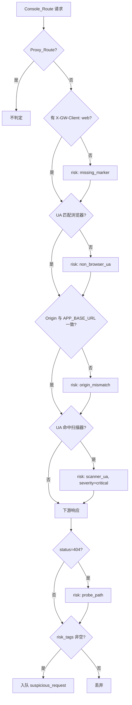
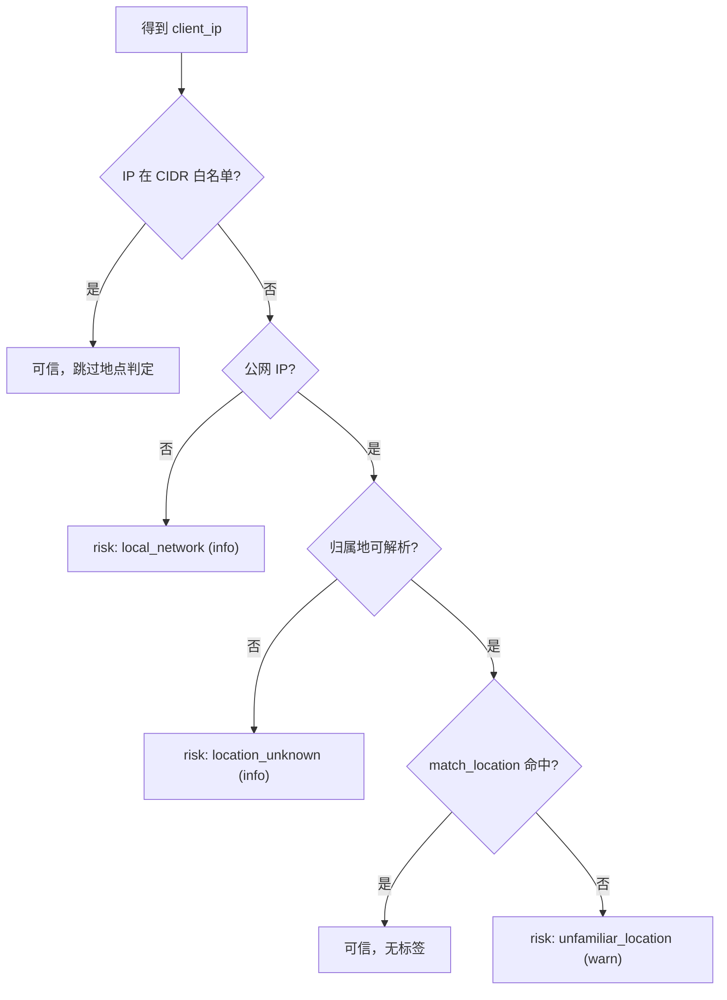

# 安全中心（Security Center）

Feature Name: 2026-10-20-security-center
Updated: 2026-10-20

## Description

在管理后台新增安全中心：统一记录管理员认证事件、前端埋点事件，并对「非前端正常发起」的请求（直接调试、非浏览器 UA、扫描探测）做风险标记与留痕，并以一个页面集中检索。

现状盘点（决定改动起点）：

- 网关**已有**请求级元数据能力：`RequestLog.client_ip / ip_location / user_agent / client_name`，由 `services/client_meta.py` 提取，`client_name` 已能识别 `curl / python-requests / Go HTTP` 等客户端；但该记录只覆盖 Proxy_Route，且**不做风险判定**。
- 管理员登录**只做内存限流**（`login_gate.py`），成功/失败/锁定**均不落库**，无法审计。
- 管理端接口调用**没有请求审计**，`/api/admin/*` 的探测与直接调试不留痕。
- 前端**没有埋点**，`lib/api.ts` 的请求也不携带任何可见的客户端标识。

设计要点与已确认决策：

- **统一事件模型**：新增单表 `security_events` 承载登录、埋点、异常请求、认证突增等事件，避免多套审计表。
- **代理接口不参与异常判定**：`/v1`、`/anthropic`、`/chat`、`/responses`、`/models`、`/mcp` 由 SDK 调用，非浏览器 UA 属正常；判定只对 Console_Route 生效（需求 3.10）。
- **写入必须离开请求热路径且不跨网络 I/O**：IP 归属地查询是外呼网络操作，遵循 `MEMORY` 既有定式（短读 → 结束事务 → 网络 I/O → 短事务写回），中间件只做**内存判定 + 入队**，由后台 worker 解析归属地并短事务落库，避免每请求写 SQLite 与 `database is locked`。
- **节流**：同一 `(event_type, ip, path, status)` 在 Dedupe_Window 内只落一条，防止扫描器把表打爆。
- **前端标识**：`lib/api.ts` 统一注入 `X-GW-Client: web`，作为「来自 Admin_Console」的判据；埋点走独立 Beacon 通道。
- **失败密码留档**：`login_failure` / `login_locked` 记录客户端提交的密码原文，入库前用 `app/crypto.py` 的对称加密（主密钥 `APP_SECRET_KEY`）加密并限长；`login_success` 只记用户名。密码字段只在单事件详情接口、且经管理员鉴权后解密返回，列表接口一律不返回。
- **自动化标记**：不只看 Beacon 的 `webdriver`，还在服务端从 UA 与请求头提取 headless/自动化信号，命中即打 `automation` 标签并把命中的信号名写进明细。
- **常用地点可配置**：新增 `security_settings`（常用地点白名单 + IP/CIDR 白名单 + 开关），归属地归一化后按「国家 / 省 / 省市」三级粒度匹配，未命中打 `unfamiliar_location`。

已确认的范围决策：

| 决策项 | 结论 |
|--------|------|
| 异常处置强度 | **仅标记并记录**：不改变响应结果，不做限流、封禁或对外告警 |
| 采集接口面 | **仅管理控制台与公开 Web**：`/api/admin/*`、`/api/public/*`、`/api/voice/*` 与管理页；Proxy_Route 与 MCP 调用不纳入（MCP 已有独立 `mcp_call_logs`） |
| 前端埋点粒度 | **关键行为 + 环境指纹**：登录/登出/关键写操作，附屏幕、时区、语言、`webdriver`；不做全量页面浏览埋点 |
| 失败密码 | **入库留档**：失败/锁定时加密存储，成功时不记录，仅详情接口向管理员展示 |
| 常用地点 | **后台可配置**：国家/省/省市三级粒度，未命中标记异地，内网与查询失败单独打 info 标签 |

## Non-Goals

- 自动封禁、自动限流、IP 黑名单等主动防御动作。
- 对外告警通知渠道（邮件/IM Webhook）。
- 全量页面浏览埋点与用户行为分析。
- 对 Proxy_Route / MCP 调用的二次审计（分别由 `request_logs`、`mcp_call_logs` 承担）。

## Architecture



判定与落库分离：中间件只读 header/path/status 并产出 Risk_Tag，绝不 `await` 外呼；归属地解析、自动化信号提取、Location_Match 与写库在 worker 内完成。

### 异常请求判定流程



## Components and Interfaces

### 1. 目录结构与改动清单

```text
backend/app/
  models.py                      # 修改：新增 SecurityEvent、SecuritySettings
  db.py                          # 修改：建表 + 索引迁移
  config.py                      # 修改：新增 security_* 配置
  services/
    security_audit.py            # 新增：判定规则、自动化信号、Location_Match、节流、内存队列、worker
    security_retention.py        # 新增：保留期清理循环
  routers/
    admin_security.py            # 新增：/api/admin/security/*、/beacon、/settings
    admin_auth.py                # 修改：登录成功/失败/锁定写事件（失败带加密密码）
  main.py                        # 修改：注册 router、挂载中间件、启动 worker/retention
frontend/src/
  lib/api.ts                     # 修改：注入 X-GW-Client: web
  lib/security.ts                # 新增：track() 埋点 + 卸载 flush
  pages/Security.tsx             # 新增：安全中心页（含常用地点设置）
  components/nav.ts              # 修改：新增「安全中心」导航项
  App.tsx                        # 修改：注册 /security 懒加载路由
```

### 2. 中间件 `SecurityAuditMiddleware`

纯 ASGI 中间件（参考 `main.py` 的 `DisableApiCacheMiddleware`），不改写 body、不阻塞下载/流式响应：

```python
class SecurityAuditMiddleware:
    def __init__(self, app, *, enabled: bool):
        self.app = app
        self.enabled = enabled

    async def __call__(self, scope, receive, send):
        if scope["type"] != "http" or not self.enabled:
            await self.app(scope, receive, send)
            return
        path = scope.get("path", "")
        headers = {k.decode().lower(): v.decode("latin-1") for k, v in scope.get("headers", [])}
        peer = scope.get("client", (None, None))[0]
        judge = judge_request(path, headers, peer)   # 纯计算，零 I/O
        status = 500

        async def send_wrapper(message):
            nonlocal status
            if message["type"] == "http.response.start":
                status = message["status"]
            await send(message)

        await self.app(scope, receive, send_wrapper)
        maybe_enqueue(judge, status, path)          # risk_tags 非空或命中节流才入队
```

中间件注册顺序：放在 `DisableApiCacheMiddleware` 之外、`CompressTextMiddleware` 之内侧（与既有中间件并列），确保拿到原始 header 且不影响压缩。

### 3. 判定规则 `services/security_audit.py`

```python
PROXY_PREFIXES = ("/v1/", "/anthropic/", "/chat", "/responses", "/models", "/mcp")
CONSOLE_PREFIXES = ("/api/admin/", "/api/public/", "/api/voice/")

BROWSER_TOKEN = re.compile(r"(Mozilla/5\.0).*(Chrome/|Firefox/|Safari/|Edg/|Version/)", re.I)
SCANNER_PATTERNS = (          # 复用并扩展 client_meta._CLIENT_PATTERNS
    "curl/", "wget/", "python-requests", "python-httpx", "httpx/", "aiohttp/",
    "go-http-client", "okhttp", "java/", "node-fetch", "undici", "axios/",
    "sqlmap", "nikto", "nmap", "nuclei", "masscan", "zgrab", "feroxbuster", "ffuf",
)

def looks_like_browser(ua: str) -> bool: ...
def judge_request(path, headers, peer) -> JudgeResult: ...
```

- `JudgeResult`：`{is_console, is_proxy, source, risk_tags, severity, client_ip, user_agent, client_name}`，其中 `source ∈ {web, api, direct}`。
- 判定优先级：先排 Proxy_Route（直接 `source=api` 且不判定），再对 Console_Route 依次叠加标签。
- 浏览器识别基于 `(Mozilla/5.0)` + 主流引擎令牌，缺失即 `non_browser_ua`；这与「UA 明显不是浏览器」一一对应。
- 扫描器字符串命中即 `scanner_ua`，级别 `critical`。
- `auth_fail_burst`：按 IP 维护滑窗计数器，登录失败与 401/403 均计入，超阈值单独成事件（与登录失败事件并存，后者由 `admin_auth` 直接产生）。

### 3.1 自动化信号（服务端 + Beacon）

```python
AUTOMATION_UA_TOKENS = (
    "headlesschrome", "headless", "phantomjs", "electron/",
    "puppeteer", "playwright", "selenium", "webdriver",
    "python-requests", "python-httpx", "go-http-client",
)

def automation_signals(user_agent: str, headers: dict[str, str], beacon=None) -> list[str]:
    signals: list[str] = []
    ua = (user_agent or "").lower()
    if looks_like_browser(user_agent):
        if any(token in ua for token in AUTOMATION_UA_TOKENS):
            signals.append("headless_ua")
        if "accept-language" not in headers:
            signals.append("missing_accept_language")
    if beacon is not None:
        if beacon.webdriver:
            signals.append("webdriver")
        if beacon.screen_w == 0 or beacon.screen_h == 0:
            signals.append("zero_screen")
    return signals
```

命中任一信号即追加 `automation` 标签，`detail["automation_signals"]` 记录具体信号名，级别取 `warn`。该函数在 worker 内执行（Beacon 事件在入队时携带其环境字段）。

### 3.2 Location_Match（常用地点匹配）

目标：把 `client_meta` 得到的归属地字符串（`_format_location` 产出形如 `中国 广东省 广州市`）与管理员配置的 Trusted_Location 做**三级粒度**匹配。

匹配前先做令牌归一化 `normalize_location(text) -> LocationTokens`：

```python
@dataclass(frozen=True)
class LocationTokens:
    country: str   # 归一化国家名，如 "中国"
    province: str  # 归一化省级名，如 "广东"
    city: str      # 归一化市级名，如 "广州"

MUNICIPALITIES = {"北京", "上海", "天津", "重庆"}
SUFFIXES = ("壮族自治区", "回族自治区", "维吾尔自治区", "自治区", "特别行政区", "省", "市")

def normalize_admin(token: str) -> str:
    text = token.strip()
    for suffix in SUFFIXES:          # 去行政后缀做统一比较
        if text.endswith(suffix):
            text = text[: -len(suffix)]
            break
    return text
```

- 解析来源字符串：按空格拆分，首段视为 country，含「省/自治区/特别行政区」的段为 province，末尾含「市」或落在 `MUNICIPALITIES` 的段为 city；直辖市令 `province == city`。
- 配置条目同样归一化为 `LocationTokens`，但允许 `city` 为空（省级条目）。

匹配规则（`match_location(tokens, trusted_entries) -> Trusted_Location | None`）：

| 条目粒度 | 命中条件 |
|----------|----------|
| 国家 | `entry.country == tokens.country` |
| 省 | `entry.country == tokens.country` and `entry.province == tokens.province` |
| 省市 | 省级条件 and `entry.city == tokens.city` |

判定顺序（`classify_location`）：



- CIDR 白名单是**强判据**：命中即视为可信，直接跳过多地点判定（应对 IP 归属地库不准）。
- 内网/回环（`client_meta._is_public` 为假）不判异地，避免本地开发被刷屏，记 `local_network` info。
- 公网但查询失败或无城市信息记 `location_unknown` info，不判异地。
- 白名单为空时，所有公网归属地都被视为未命中，打 `unfamiliar_location`（需求 8.10）。
- 归属地查询复用 `client_meta.lookup_ip_location` 的进程内缓存（成功 6h / 失败 10min），不会因安全中心而放大外呼。

### 4. 队列与 worker（离开热路径）

```python
@dataclass(slots=True)
class PendingEvent:
    event_type: str
    severity: str
    source: str
    peer: str | None
    headers: dict[str, str]
    method: str
    path: str
    status: int
    risk_tags: list[str]
    detail: dict[str, Any] | None = None
    actor: str | None = None
    attempted_password: str | None = None   # 仅失败/锁定事件，短生命周期，加密后即弃
    beacon: dict[str, Any] | None = None    # Beacon 环境字段，供自动化信号判定

_QUEUE: asyncio.Queue[PendingEvent] = asyncio.Queue(maxsize=2000)
_LAST_EMIT: dict[tuple, float] = {}     # 节流指纹 → 上次落库时间

async def audit_worker() -> None:
    while True:
        event = await _QUEUE.get()
        try:
            ip = client_ip(event.headers, peer=event.peer)
            location = await lookup_ip_location(ip)              # 网络 I/O，事务外
            trusted = load_trusted_locations()                   # 短读快照，事务外
            event.risk_tags += location_tags(ip, location, trusted)
            event.risk_tags += automation_signals(event.headers.get("user-agent", ""), event.headers, event.beacon)
            _write_event(event, ip, location)                    # 独立短事务
        finally:
            _QUEUE.task_done()
```

- 队列满时丢弃并打日志，绝不阻塞请求。
- `_write_event` 用新的 `Session`，单条 `insert + commit`，与 MEMORY 中「写事务不跨网络 I/O」定式一致；失败密码用 `encrypt_secret` 加密后写入 `attempted_password_encrypted`。
- worker 在 `lifespan` 中以 `asyncio.create_task` 启动，随其余后台任务统一 `cancel`。

### 5. 登录审计改造（`admin_auth.py`）

登录端点增加 `request: Request`，在既有控制流上旁挂事件（不改变响应行为）：

```python
@router.post("/login", response_model=LoginResponse)
def login(payload: LoginRequest, request: Request, db: Session = Depends(get_db)):
    meta = client_meta(dict(request.headers), peer=request.client.host if request.client else None)
    try:
        login_gate.check(payload.username)
    except LoginLocked:
        enqueue_login_event("login_locked", payload.username, meta,
                            severity="warn", attempted_password=payload.password)
        raise HTTPException(429, "登录失败次数过多，请稍后再试")
    admin = ...
    if admin is None or not verify_password(...):
        login_gate.fail(payload.username)
        enqueue_login_event("login_failure", payload.username, meta,
                            attempted_password=payload.password)   # 加密后入库，限长 SECURITY_MAX_PASSWORD_LEN
        record_auth_failure(meta["client_ip"])          # 供 auth_fail_burst
        raise HTTPException(401, "用户名或密码错误")
    login_gate.succeed(payload.username)
    enqueue_login_event("login_success", admin.username, meta)     # 成功不记密码
    admin.last_login_at = utcnow()
    return LoginResponse(...)
```

- 密码在 worker 内 `encrypt_secret(payload.password[:SECURITY_MAX_PASSWORD_LEN])` 后写入密文列，明文只在入队对象内短生命周期存在；`login_success` 的事件对象不携带密码。
- 详情接口 `GET /api/admin/security/events/{id}` 对 `login_failure` / `login_locked` 返回解密后的 `attempted_password`；列表接口永不带该字段。

`update_me` 成功改密/改用户名后写入 `admin_credential_change`（`warn`）。登出为无状态操作，由前端 Beacon 上报 `logout`。

### 6. Beacon 接口 `routers/admin_security.py`

```python
@router.post("/beacon", status_code=204)
def beacon(payload: BeaconRequest, request: Request, admin: Admin = Depends(get_current_admin), db=...):
    if not gate.allow(admin.username):        # 单管理员固定窗口限流
        return Response(status_code=204)      # 静默丢弃，不报错
    meta = client_meta(dict(request.headers), peer=...)
    signals = automation_signals(meta["user_agent"] or "", dict(request.headers), beacon=payload)
    severity = "warn" if signals else "info"
    enqueue_frontend_event(payload, admin.username, meta, severity=severity, automation_signals=signals)
```

`BeaconRequest` 字段（全部为环境与行为，**不含任何凭据**）：`event`、`path`、`client_time`、`timezone`、`language`、`screen_w`、`screen_h`、`dpr`、`platform`、`webdriver`、`action`、`target`。命中任一自动化信号（`webdriver`、零屏幕、缺失 `Accept-Language`、headless UA）即附加 `automation` 标签并把信号名写入明细。

### 7. 前端埋点 SDK `lib/security.ts`

```ts
const buffer: BeaconEvent[] = []

export function track(event: string, detail: Partial<BeaconEvent> = {}) {
  buffer.push({ event, path: location.pathname, client_time: Date.now(), ...clientEnv(), ...detail })
  if (buffer.length >= 10) flush()
}

function clientEnv() {
  return {
    timezone: Intl.DateTimeFormat().resolvedOptions().timeZone,
    language: navigator.language,
    screen_w: screen.width, screen_h: screen.height,
    dpr: window.devicePixelRatio,
    platform: navigator.platform,
    webdriver: (navigator as any).webdriver === true,
  }
}

export function flush() {
  if (!buffer.length) return
  const events = buffer.splice(0)
  // keepalive 允许页面卸载期间完成请求，并能带 Authorization 头
  fetch('/api/admin/security/beacon', {
    method: 'POST', keepalive: true,
    headers: { 'Content-Type': 'application/json', Authorization: `Bearer ${getToken()}` },
    body: JSON.stringify(events),
  }).catch(() => {})
}

window.addEventListener('pagehide', flush)
```

埋点时机：登录成功后 `track('session_start')`；关键写操作（新建/删除 Key、改上游账号、改密）`track('admin_action', { action, target })`；`App.tsx` 中 `clearToken` 前 `track('logout')` 并 `flush()`。

### 8. 安全中心页面 `pages/Security.tsx`

- 路由 `/security`，`nav.ts` 在「平台」分组新增 `{ to: '/security', label: '安全中心', icon: Shield }`，并加入命令面板关键词（`security 安全 审计 登录 异常`）。
- 布局沿用现有 `filter-bar` + 分页 + `ui.tsx` 组件，响应式（PC 表格 / 移动卡片，遵循 MEMORY 的双端约束）。
- 顶部概览卡：选定时间范围内的登录成功数、登录失败数、异常请求数、独立来源 IP 数；下方为事件趋势（复用 `components/charts`）。
- Tab：登录日志、异常与调试请求、前端埋点、全部事件、设置；前四个均支持 `since/until/type/severity/source/ip/q` 过滤与分页；行点击打开详情抽屉，展示完整 `detail_json`、Risk_Tag 与自动化信号。
- 登录日志行在失败/锁定时通过详情抽屉提供「显示本次尝试密码」按钮，点击才请求 `GET /api/admin/security/events/{id}` 取解密值；列表不携带该字段。
- 「设置」Tab 管理常用地点与 IP 白名单：地点以「国家 / 省 / 省市」三级录入（如 `中国`、`中国 广东省`、`中国 广东省 广州市`），列表展示归一化后的国家/省/市与启用开关；IP 白名单支持单 IP 与 CIDR，附「是否启用地点判定」总开关。

### 9. 后端接口

| 方法 | 路径 | 说明 |
|------|------|------|
| GET | `/api/admin/security/overview` | 概览计数与趋势（按时间范围） |
| GET | `/api/admin/security/events` | 分页列表，支持 type/severity/source/ip/q/since/until；**不返回** attempted_password |
| GET | `/api/admin/security/events/{id}` | 事件详情；失败/锁定事件返回解密后的 attempted_password |
| POST | `/api/admin/security/beacon` | 前端埋点（管理员鉴权） |
| GET | `/api/admin/security/settings` | 读取常用地点、IP 白名单与开关 |
| PUT | `/api/admin/security/settings` | 覆盖保存常用地点与 IP 白名单（整体替换语义） |

列表实现对齐 `routers/admin_mcp_calls.py` 的 `filters + total + offset/limit` 写法；概览聚合走 `COUNT/COUNT(DISTINCT client_ip)`，必要时对照 `admin_dashboard.py` 的快照思路做轻量预计算。设置接口对地点条目做归一化校验后落 `security_settings`。

### 10. 配置项（`config.py`）

| 配置 | 默认 | 说明 |
|------|------|------|
| `security_audit_enabled` | True | 安全审计与中间件总开关 |
| `security_beacon_enabled` | True | 前端埋点通道开关 |
| `security_event_retention_days` | 90 | 事件保留天数 |
| `security_dedupe_window_seconds` | 30 | 同指纹节流窗口 |
| `security_max_password_len` | 256 | 失败密码入库前的截断长度 |
| `security_beacon_rate_limit` | 60 | 单管理员每窗口允许的 Beacon 数 |
| `security_auth_fail_threshold` | 10 | 触发 `auth_fail_burst` 的失败次数阈值 |
| `security_auth_fail_window_seconds` | 300 | 认证失败统计窗口 |

复用既有 `ip_geo_url`、`trusted_proxy_cidrs`、`app_base_url`；`SECURITY_AUDIT_ENABLED=false` 时中间件与登录审计整体旁路，便于排障。

## Data Models

### SecurityEvent（`security_events`）

| 字段 | 类型 | 说明 |
|------|------|------|
| id | Integer PK | 自增 |
| event_type | String(32) | `login_success` / `login_failure` / `login_locked` / `logout` / `admin_credential_change` / `suspicious_request` / `auth_fail_burst` / `frontend_beacon` |
| severity | String(16) | `info` / `warn` / `critical` |
| source | String(16) | `web` / `api` / `direct` |
| actor | String(128) | 管理员用户名或 API Key 名，匿名为空 |
| attempted_password_encrypted | Text | 失败/锁定事件的尝试密码密文，成功事件为空 |
| client_ip | String(64) | 来源 IP |
| ip_location | String(128) | 归属地（worker 异步补齐） |
| location_trusted | Boolean | 归属地是否命中常用地点（内网/未知为 null） |
| location_rule | String(256) | 命中的常用地点条目，未命中为空 |
| user_agent | String(512) | 原始 UA |
| client_name | String(64) | 解析出的客户端标识 |
| client_version | String(64) | 从 UA 解析出的客户端版本 |
| request_headers | Text | 脱敏后的请求头 JSON |
| method | String(8) | HTTP 方法 |
| path | String(512) | 请求路径（不含 query） |
| status_code | Integer | 响应状态码 |
| outcome | String(16) | `success` / `rejected` / `failed` / `unknown` |
| risk_tags | Text | JSON 数组字符串（含 `automation`、`unfamiliar_location` 等） |
| detail_json | Text | 事件明细（已脱敏，含 `automation_signals`） |
| created_at | DateTime | UTC，索引 |

索引：`(created_at)`、`(event_type, created_at)`、`(client_ip, created_at)`、`(severity, created_at)`。

### SecuritySettings（`security_settings`，单行配置）

| 字段 | 类型 | 说明 |
|------|------|------|
| id | Integer PK | 固定为 1 |
| location_check_enabled | Boolean | 常用地点判定总开关 |
| trusted_locations_json | Text | 条目数组：`[{country, province, city, raw, enabled}]`，city 可空 |
| ip_allowlist_json | Text | IP / CIDR 白名单数组：`["1.2.3.4", "10.0.0.0/8"]` |
| updated_at | DateTime | 最近更新时间 |

`security_audit.load_trusted_locations()` 读取并缓存该行（带 TTL），保存设置后失效缓存；worker 用它做 Location_Match，避免每个事件都查库。

建表走 `models.py` 声明 + `db.py` 的 `CREATE INDEX IF NOT EXISTS` 迁移段，与现有 `ContentAuditFinding` 等表一致。

## Correctness Properties

1. **路由隔离**：任何 Proxy_Route 请求都不会产生 `non_browser_ua`、`missing_marker`、`probe_path` 事件。
2. **热路径无阻塞**：请求处理过程中不出现 SQLite 写操作与上游网络调用；归属地解析、Location_Match 与落库只发生在 worker。
3. **脱敏不变式**：`detail_json` 与 `user_agent` 中不出现 `Authorization`、`Cookie`、`api_key` 等明文（复用 `main.redact_secret_query` 与既有 `dump_headers` 脱敏策略）；唯一例外是加密后的 `attempted_password_encrypted` 列。
4. **密码密文不变式**：`attempted_password_encrypted` 在任何时刻都是密文；成功登录事件的该列为空；明文只存在于入队对象内，落库前即加密。
5. **节流有界**：同一指纹在 Dedupe_Window 内最多一条事件；队列长度不超过 `maxsize`，溢出丢弃。
6. **地点判定确定性**：给定相同 `(ip, location, trusted_entries)`，Location_Match 结果稳定；条目粒度只会放宽命中范围（国家 ⊇ 省 ⊇ 省市）。
7. **可删可清**：保留期清理只删除 `security_events` 中早于阈值的行，不影响其他表与 `security_settings`。

## Error Handling

| 场景 | 处理 |
|------|------|
| 队列已满 | 记 `[security] queue full` 日志并丢弃，请求不受影响 |
| IP 归属地查询失败/超时 | `lookup_ip_location` 既有逻辑返回 `None`，标记 `location_unknown` 并照常落库 |
| 归属地库对公网 IP 无城市信息 | 归为 `location_unknown`（info），不误判异地 |
| 常用地点配置为空 | 所有公网归属地记为 `unfamiliar_location`；页面显式提示未配置 |
| 密码解密失败 | 详情接口返回密码字段为 null，并在响应中标记 `password_unavailable` |
| Beacon 超过限流 | 返回 204 静默丢弃，避免暴露限流细节 |
| Beacon 无有效 JWT | 由 `get_current_admin` 返回 401 |
| 建表/迁移失败 | 启动期异常同上；迁移语句幂等（`IF NOT EXISTS`） |
| 事件写入异常 | worker 捕获并打日志，不中断循环 |

## Test Strategy

- 单元测试 `backend/tests/test_security_audit.py`：
  - `judge_request` 对 Proxy_Route 返回空标签；对无 marker 的 `/api/admin/x` 返回 `missing_marker`；对 curl UA 返回 `non_browser_ua` + `scanner_ua`；对 404 probe 返回 `probe_path`。
  - 浏览器 UA（Chrome/Safari/Firefox）无 `non_browser_ua`。
  - `automation_signals`：`HeadlessChrome` UA 命中 `headless_ua`；Beacon `webdriver=true` 命中 `webdriver`；零屏幕命中 `zero_screen`；缺失 `Accept-Language` 命中 `missing_accept_language`。
  - `normalize_location`：`中国 广东省 广州市` → `(中国, 广东, 广州)`；`北京市` 的 province 与 city 均为 `北京`。
  - `match_location`/`classify_location`：国家/省/省市三级条目命中与未命中；IP 白名单绕过；内网 IP → `local_network`；查询失败 → `location_unknown`；空配置 → `unfamiliar_location`。
  - 节流：同指纹连续入队只落一条。
  - 脱敏：构造带 `Authorization`/`Cookie` 的 header，断言落库无明文。
- 接口测试 `backend/tests/test_admin_security.py`：
  - 登录成功/失败/锁定各写入对应事件；失败事件可解密还原提交的密码且长度受限；成功事件密码列为空。
  - 列表接口响应体不含 `attempted_password*` 字段。
  - 设置读写：保存常用地点后未命中/命中的事件标签随之变化。
  - 未认证访问 `/api/admin/security/*` 返回 401；Beacon 超限静默。
  - 列表过滤与分页正确。
- 运行方式遵循 MEMORY：`cd backend && PYTHONPATH=. python3 -m pytest tests/test_security_audit.py tests/test_admin_security.py`。
- 前端类型检查：`cd frontend && npx tsc -b`。

## References

[^1]: (File) backend/app/services/client_meta.py - 既有 IP/UA/client_name 提取与归属地缓存，判定规则复用其模式表
[^2]: (File) backend/app/routers/admin_auth.py - 登录端点，改造点
[^3]: (File) backend/app/login_gate.py - 现有内存登录限流
[^4]: (File) backend/app/main.py - 中间件与 lifespan 挂载点
[^5]: (File) backend/app/routers/admin_mcp_calls.py - 列表接口参考样板
[^6]: (File) backend/app/models.py - ContentAuditFinding 等审计表示例
[^7]: (File) frontend/src/lib/api.ts - 前端请求封装，注入 X-GW-Client
[^8]: (File) backend/app/crypto.py - 对称加解密与脱敏工具，失败密码与既有 API Key 复用同一主密钥
[^9]: (Website) Next Terminal - [登录日志与异常访问审计的产品参考](https://github.com/dushixiang/next-terminal)
