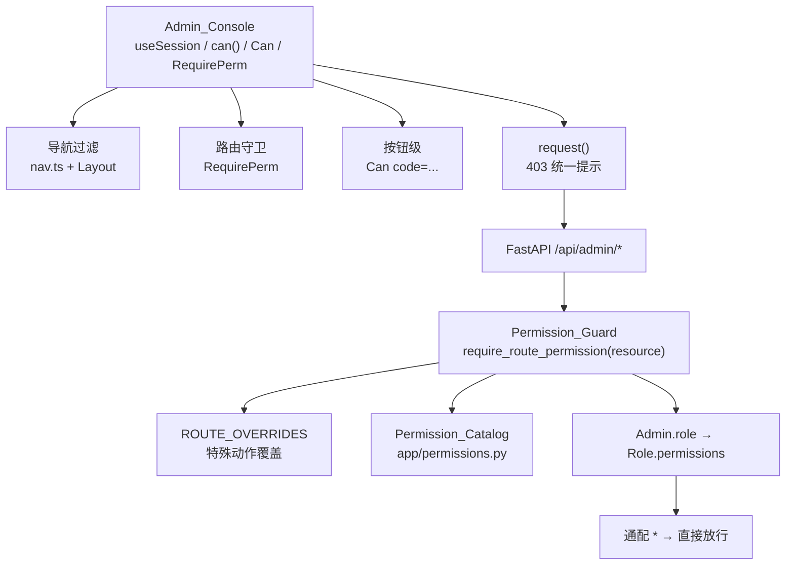

# 用户与角色权限（Role & Permission）

Feature Name: 2026-10-23-role-permissions
Updated: 2026-10-23

## Description

把管理后台从「单账号、登录即全权」升级为「账号 → 单个角色 → 权限点集合」的 RBAC：权限点细化到页面上的具体功能，后端逐个 `/api/admin/*` 接口强制校验，前端按权限隐藏入口与按钮，整套判定只保留一份真源与一个封装。

现状盘点（决定改动起点）：

- 认证只有 `Admin` 表，字段为 `username / password_hash / token_version / last_login_at`（`backend/app/models.py:15`），无角色概念。
- `get_current_admin`（`backend/app/deps.py:30`）每个请求都用 JWT 的 `sub` 回库查 `Admin` 并用 `token_version` 判失效。**因为权限不写进 JWT，权限变更天然对下一次请求生效**，无需重新登录。
- 管理接口共 40 个路由文件、约 150 个接口（`backend/app/main.py:190`），全部只要求登录，没有功能级校验。
- 前端没有会话/权限状态：`lib/api.ts:3` 存 token，`App.tsx:104` 的 `Guard` 只判断「有没有 token」；导航是静态表 `nav.ts:37`；路由为 13 个一级页 + 30 余子页（`App.tsx:149`）。
- 升级入口 `seed_admin()`（`backend/app/seed.py:14`）只在库中无 `Admin` 时建号，因此生产的现有账号即「唯一管理员」。
- 图片/视频生成是**同一套**接口（`backend/app/routers/admin_generation.py`），按请求体 `kind` 区分（`generation/service.py`），两个页面共用 `GenerationWorkspace`（`frontend/src/pages/ImageGen.tsx`）。

已确认的范围决策：

| 决策项 | 结论 |
|--------|------|
| 权限粒度 | **页面 × 动作**，约 140 个权限点，角色编辑页按页面分组勾选 |
| 账号与角色 | **一个账号绑定恰好一个角色**，不做多角色叠加 |
| 图片 / 视频生成 | **拆成两个资源**，按请求体 `kind` 与任务自身 `kind` 校验；配置与参考素材共用一套接口，归到共享的 `generation` 资源 |
| 数据级权限 | 不纳入本轮，只做功能级 |
| 前端无权限 | 隐藏入口与按钮，直连 URL 跳转无权限页；后端 403 兜底并提示 |

## Architecture



判定链路：请求进入 `/api/admin/*` → `get_current_admin` 解出 `Admin`（`deps.py:30`）→ `Permission_Guard` 依据该路由的 `Resource` 与覆盖表得到 Route_Permission → 角色持有通配 `*` 或包含该 Permission 即放行，否则 403。

### 页面依赖的只读接口

页面进入时会加载筛选器、分组、供应商等只读数据，这些查询不能要求用户具备对应的管理权限，否则只读角色会在页面加载时收到 403。`ROUTE_ANY_CODES` 为这类接口登记「任一命中即可」的权限集合，例如：

- `GET /api/admin/accounts`：`accounts:view` / `benchmark:view` / `logs:view` / `keys:view` 等（列表不含密钥明文）；
- `GET /api/admin/keys`：`keys:view` / `logs:view`；
- `GET /api/admin/benchmark/groups`：`benchmark_groups:view` / `benchmark:view` / `benchmark_history:view`；
- `GET /api/admin/generation/settings`：`generation:settings` 或对应 kind 的查看/创建权限；
- `GET /api/admin/integrations/tikhub`：`integrations:view` / `info:view` / `mcp_douyin:view`。

写入仍走原权限码；`resolve_permission` 返回集合首项作为主权限，供目录覆盖测试使用。涉及密钥明文的读取（如 `accounts?reveal=1`）额外要求 `accounts:update`。

## Components and Interfaces

### 后端

**1）权限目录（唯一真源）** `backend/app/permissions.py`

```python
CATALOG: dict[str, tuple[str, tuple[tuple[str, str], ...]]] = {
    # resource: (页面名, ((action, 动作名), ...))
    "accounts": ("上游账号", (
        ("view", "查看"), ("create", "新增"), ("update", "编辑"), ("delete", "删除"),
        ("import", "导入"), ("export", "导出"), ("probe", "连通性测试"),
        ("quota", "刷新额度"), ("models_manage", "模型目录维护"),
    )),
    # ...
}

ADMIN_ROLE_NAME = "管理员"
WILDCARD = "*"

def all_permissions() -> set[str]: ...          # 展开为 {"accounts:view", ...}
def codes_for(resource: str, action: str) -> str: ...   # "accounts:view"
def validate_codes(codes: Iterable[str]) -> list[str]: ...  # 返回非法码
```

**2）路由 → 权限映射** `backend/app/services/permission_guard.py`

```python
DEFAULT_ACTIONS = {"GET": "view", "POST": "create", "PUT": "update", "PATCH": "update", "DELETE": "delete"}

ROUTE_OVERRIDES: dict[tuple[str, str], str] = {
    # (method, path_template) -> permission code
    ("POST", "/api/admin/accounts/export"): "accounts:export",
    ("POST", "/api/admin/accounts/import"): "accounts:import",
    ("POST", "/api/admin/accounts/{account_id}/probe"): "accounts:probe",
    ("POST", "/api/admin/accounts/{account_id}/quota"): "accounts:quota",
    ("POST", "/api/admin/accounts/{account_id}/models"): "accounts:models_manage",
    ("GET",  "/api/admin/logs/{log_id}/export"): "logs:export",
    ("GET",  "/api/admin/logs/{log_id}/messages"): "logs:messages",
    ("GET",  "/api/admin/logs/{log_id}"): "logs:detail",
    ("POST", "/api/admin/jobs/{job_id}/run"): "jobs:run",
    ("PATCH", "/api/admin/jobs/{job_id}"): "jobs:edit",
    # keys / skills / tools / mcp_* 等特殊动作同样在此登记
}

def require_route_permission(resource: str) -> Callable: ...  # 生成 FastAPI 依赖
```

- 依赖实现：从 `request.scope["route"]` 取 `path` 与 `methods`，先查 `ROUTE_OVERRIDES`，未命中则用 `DEFAULT_ACTIONS[method]` 拼 `f"{resource}:{action}"`；再取 `admin` 的权限集合判定。
- 挂载方式：所有需要登录的管理 router 统一挂到一个 `APIRouter(dependencies=[Depends(require_admin_permission)])` 父路由下（`main.py`），登录、`/me`、OAuth 回调与签名令牌资产路由不挂；权限按“路由前缀 → 资源 + HTTP 方法 → 默认动作”推导，不逐个函数写装饰器。
- 需要读请求体的接口（生成任务创建）用 `require_generation_task_create`：依赖内 `await request.json()`（FastAPI 已缓存 `_body`，不会二次读取流），按 `kind` 映射到 `image_gen` / `video_gen`。
- 需要按资源自身 kind 校验的接口（任务的读/删/重试）用 `require_generation_task_access(action)`：依赖内按路径参数查一次 `GenerationTask.kind`，再判定对应资源；列表接口按可授权的 kind 过滤。
- 放行清单（不装 Guard）：`/api/admin/login`、`/api/admin/me`、`/api/admin/security/beacon`、`/api/admin/generation` 的资产路由（签名令牌鉴权，见 `admin_generation.py:19`）。
- 测试保障：`test_permission_catalog.py` 遍历 `app.routes`，断言每个 `/api/admin/*` 路由（除放行清单）都能解析出 Permission，且解析结果都在 `CATALOG` 内；新增接口忘记登记时测试失败。

**3）模型与接口**

- `Admin` 增加 `role_id`（nullable，FK `roles.id`）与 `is_enabled`（默认 true）。
- 新增 `Role`：`id / name(unique) / builtin / permissions_json / created_at / updated_at`。
- `GET /api/admin/me`（`admin_auth.py:58`）返回 `{username, role: {id, name, builtin}, permissions: [...]}`，前端只依赖这一次响应。
- 新增 `backend/app/routers/admin_users.py`：`GET /users`、`POST /users`、`PATCH /users/{id}`、`DELETE /users/{id}`、`POST /users/{id}/password`、`POST /users/{id}/status`。
- 新增 `backend/app/routers/admin_roles.py`：`GET /roles`、`POST /roles`、`PATCH /roles/{id}`、`DELETE /roles/{id}`、`GET /permission-catalog`。
- 防提权（需求 11）：非通配持有者创建/更新角色时，`validate_codes` 之外再校验 `codes ⊆ 自身权限`；分配角色时校验目标角色 `⊆ 自身权限`；内置「管理员」角色仅通配持有者可分配。

### 前端

**1）会话状态** `frontend/src/lib/session.tsx`（新增）

```tsx
export type Me = { username: string; role: { id: number; name: string; builtin: boolean }; permissions: string[] }
export function SessionProvider({ children })                    // 拉 /api/admin/me，缓存到 react-query
export function useSession(): { me?: Me; isLoading: boolean; can: (code: string) => boolean }
export function useCan(code: string): boolean
export function Can({ code, children, fallback }: ...)           // 无权限不渲染
export function RequirePerm({ code, children }: ...)             // 无权限渲染 <ForbiddenPage/>
```

`can(code)` 规则：`role.builtin === true` 直接 true；否则 `permissions.includes(code)`，并支持 `resource:*` 通配。

**2）三处接入（各一处，页面零重复）**

- 导航：`nav.ts` 的 `NavLink` 增加可选 `perm` 字段，`Layout` 用 `can` 过滤 `NAV_GROUPS` / `TAB_LINKS` / 命令面板。
- 路由：`App.tsx` 每个 element 包 `<RequirePerm code="accounts:view">`，保留 `Guard` 的登录判定。
- 按钮：页面内 `<Can code="accounts:delete"><Button/></Can>`，需要条件逻辑时用 `useCan('logs:export')`。

**3）403 兜底**：`lib/api.ts` 的 `request()`（`api.ts:52`）在 `response.status === 403` 时用 `toast` 呈现后端文案，避免绕过按钮后静默失败。

**4）新增页面**：`frontend/src/pages/Users.tsx`、`frontend/src/pages/Roles.tsx`（角色编辑含权限目录分组勾选、整页全选/清空），入口挂在「平台」分组末尾，`perm` 分别为 `users:view` / `roles:view`。

## Data Models

```text
roles
  id             INTEGER PK
  name           VARCHAR(64) UNIQUE NOT NULL
  builtin        BOOLEAN NOT NULL DEFAULT 0
  permissions_json TEXT NOT NULL DEFAULT '[]'   -- ["accounts:view", ...] 或 ["*"]
  created_at     DATETIME NOT NULL
  updated_at     DATETIME NOT NULL

admins（新增列）
  role_id        INTEGER NULL  REFERENCES roles(id)
  is_enabled     BOOLEAN NOT NULL DEFAULT 1
```

迁移（`backend/app/db.py` 的 `_ensure_columns` 内，幂等）：

1. `roles` 表由 `Base.metadata.create_all` 建（`db.py:72-73`），`admins.role_id` / `admins.is_enabled` 用 `ALTER TABLE ADD COLUMN`（nullable / 常量默认，不重写表）。
2. 种子：若不存在 `builtin=1` 的角色，插入「管理员」`permissions_json='["*"]'`。
3. 回填：`UPDATE admins SET role_id = <管理员id> WHERE role_id IS NULL`（需求 10.1）。
4. 兜底：查询时 `role_id IS NULL` 视为通配（需求 10.2），避免升级中途锁死。

## 权限点全表

| 页面（Resource） | 动作（Action） |
|---|---|
| 概览 `dashboard` | view, refresh |
| 上游账号 `accounts` | view, create, update, delete, import, export, probe, quota, models_manage |
| 网关代理 `agents` | view, create, update, delete, route_bind |
| API Key `keys` | view, create, update, delete, reveal, aliases_manage, cc_switch |
| 记录审计 `logs` | view, detail, messages, export |
| 模型测速 `benchmark` | view（仅页面入口）, run |
| 测速分组 `benchmark_groups` | view, manage |
| 测速历史 `benchmark_history` | view, detail, export |
| 模型榜 `leaderboard` | view |
| 资讯收集 `info` | view, source_create, source_update, source_delete, collect, preview, article_create, article_update, article_delete, favorite, hidden, featured, ai_skip, ai_settings, rescore |
| 图片生成 `image_gen` | view, task_create, task_retry, task_delete, settings |
| 视频生成 `video_gen` | view, task_create, task_retry, task_delete, settings |
| 生成配置（共享）`generation` | settings, upload |
| 离线下载 `offline` | view, resolve（解析上游）, task_create, task_delete, retry |
| Skills `skills` | view, upload, update, delete, category_manage, analysis, download |
| Skills 组合包 `skill_bundles` | manage |
| 安全中心 `security` | view, event_detail, settings |
| MCP 目录 `mcp_catalog` | view |
| MCP 知识库 `mcp_knowledge` | view, kb_create, kb_update, kb_delete, doc_upload, doc_delete, doc_reembed, search |
| MCP 文档解析 `mcp_docparse` | view, job_create, job_cancel, job_retry, job_delete, download, ingest |
| MCP 站点 `mcp_sites` | view, site_create, site_update, site_delete, version_create, version_activate, version_retry, version_delete, token_manage |
| MCP 抖音 `mcp_douyin` | view, job_create, job_retry, job_delete, provider_manage |
| MCP 图表 `mcp_diagrams` | view, generate, update, rollback, delete, token_manage |
| MCP Key `mcp_keys` | view, create, update, delete, capabilities_manage, reveal, integration |
| MCP 调用日志 `mcp_calls` | view |
| 工具中心 `tools` | view, create, update, delete, run, stop, script_edit, download |
| 定时任务 `jobs` | view, run, edit |
| 语音房 `voice` | view, manage |
| 第三方集成 `integrations` | view, update |
| 公开门禁 `public_gate` | view, update |
| 用户管理 `users` | view, create, update, delete, reset_password, toggle_status |
| 角色管理 `roles` | view, create, update, delete |

## Correctness Properties

1. 通配持有者对任一 `/api/admin/*` 接口都放行；升级后现有账号行为与升级前逐接口一致。
2. 不存在任何可编辑或删除内置「管理员」角色的路径（需求 2.2）。
3. 系统始终保留至少一个**启用中**的通配持有者账号（需求 4.2 / 4.3）；非通配持有者不能改密、停用或删除权限高于自己的账号。
4. 每个 `/api/admin/*` 接口都解析出确定且合法的 Route_Permission；覆盖表与「任一命中」集合中的每个 code 都存在于 `CATALOG`。
5. 非通配持有者创建/更新的角色权限、分配的角色权限，均为其自身权限的子集。
6. 生成的列表接口只返回请求者被授权的 kind。
7. 权限校验结论只依赖「当前角色权限集合」与「路由」，不依赖请求体中的其他字段。

## Error Handling

| 场景 | 响应 |
|---|---|
| 缺权限 | 403，`{"detail": {"error": {"type": "permission_denied", "message": "无权限：删除上游账号", "permission": "accounts:delete"}}}` |
| 角色仍被账号引用 | 409，含引用账号数量 |
| 删除/降级最后一个管理员 | 409，文案说明需保留至少一个管理员 |
| 用户名重复 | 409 |
| 权限码非法 | 400，列出非法码 |
| 子集约束不满足 | 403，指出越权的权限码 |
| 账号停用或改密后的旧会话 | 401（复用 `token_version`，`deps.py:47`） |

前端：`Can` 不渲染控件；直连 URL 进 `ForbiddenPage`；`request()` 收到 403 弹提示（含后端文案）。

## Test Strategy

后端（pytest，沿用 `tests/conftest.py` 的 `client` / `auth_headers`）：

- 目录与覆盖完整性：遍历 `app.routes` 断言每条 `/api/admin/*` 都能解析权限，且 code 落在 `CATALOG`；放行清单显式断言。
- 逐接口鉴权参数化：登录一个仅持有单一权限的角色，断言目标接口 200 / 其余 403（按 Resource 分组跑）。
- 防提权：非通配用户创建含越权码的角色 → 403；分配内置角色 → 403；分配超集角色 → 403。
- 保护性约束：删内置疑角色 → 403；删最后一个管理员 → 409；删被引用角色 → 409；重复用户名 → 409。
- 生成分权：`kind=image` 只持 `video_gen:*` → 403；列表按权限过滤；`GET /tasks/{id}` 按任务 kind 判定。
- 升级迁移：构造「有 admin、无 roles、role_id 为 NULL」的旧库，跑 `init_db()` 后断言生成内置角色、账号已绑定、`/me` 返回通配。
- 会话：改密/停用后旧 token → 401；改角色权限后旧 token 立即生效（无需重登）。

前端（无既有测试框架，先补最小可测边界）：

- 纯函数单测（新增 `vitest` 或直接 Node 断言脚本）：`can()` 的通配与集合判定、导航过滤结果、权限目录分组。
- 类型与静态检查：`tsc -b`、`eslint`。
- 手工自测清单：管理员全量可见；仅 `logs:view` 的角色看不到其他入口、记录页无导出按钮、直连 `/accounts` 跳无权限页。

## 分阶段实施

- **P0 骨架**：`permissions.py` 目录 + `permission_guard` + 覆盖表 + 模型与迁移 + `/me` 扩展 + `admin_users.py` / `admin_roles.py` + 前端 `session.tsx` / `Can` / `RequirePerm` / 导航过滤 / `Users` 与 `Roles` 页 + 403 兜底。
- **P1 网关核心页**：概览、上游账号、网关代理、API Key、记录审计的权限点接入与按钮改造。
- **P2 其余页**：模型、内容、平台、MCP 各子页的权限点接入与按钮改造。
- 每阶段收尾跑全量 `pytest`、`tsc -b`、`eslint`，并补对应鉴权测试。

## References

[^1]: `backend/app/deps.py#L30` - 当前唯一的鉴权依赖，权限判定的挂载点。
[^2]: `backend/app/models.py#L15` - `Admin` 模型，新增 `role_id` / `is_enabled`。
[^3]: `backend/app/main.py#L190` - 全部 admin 路由的注册位置，决定 Guard 挂载面。
[^4]: `backend/app/routers/admin_generation.py#L19` - 生成接口与签名令牌资产路由，分权映射依据。
[^5]: `frontend/src/App.tsx#L104` - 现有 `Guard` 与路由表，新增 `<RequirePerm>`。
[^6]: `frontend/src/components/nav.ts#L37` - 导航配置，新增 `perm` 字段与过滤。
[^7]: `frontend/src/lib/api.ts#L52` - 请求封装，新增 403 统一提示。
[^8]: `backend/app/seed.py#L14` - 现有单账号引导逻辑，迁移时绑定内置角色。
