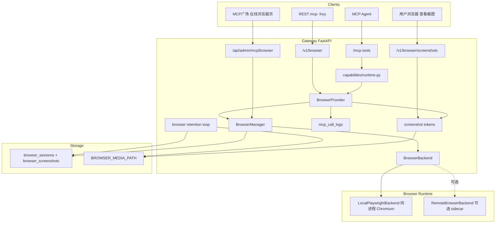

# MCP 广场在线浏览器（Browser Automation）

Feature Name: 2026-10-25-browser-automation
Updated: 2026-10-25

## Description

在能力平面新增 `browser`：AI 通过 MCP 工具远程控制服务端无头 Chromium，完成导航、快照、点击、输入、等待与截图；截图保存到平台媒体目录，并以带签名的公开链接回传给用户。能力以浏览器会话为隔离单位，归属 MCP Key，复用现有鉴权、白名单与调用日志。

底层引擎为 Playwright（Python）。运行形态支持两种：
- **同容器（默认 v1）**：Playwright 与 Chromium 运行在网关进程内，通过 `BrowserManager` 管理浏览器与上下文。
- **独立浏览器 worker（生产推荐）**：Chromium 运行在侧车容器，网关通过内部 HTTP 调用；两者共享截图卷。实现通过 `BrowserBackend` 抽象切换。

## 选型研究

| 方案 | 说明 | 优点 | 缺点 | 结论 |
| --- | --- | --- | --- | --- |
| 官方 `@playwright/mcp`（Node） | 微软官方 MCP，提供 `browser_navigate/click/type/snapshot/screenshot` 等 20+ 工具，有官方镜像 `mcr.microsoft.com/playwright/mcp` | 工具成熟、快照与 ref 机制完善、可快速接入 | 单个 server 进程只维护一套浏览器状态，多租户隔离需一会话一进程；截图结果需从 MCP 内容里解析落盘；Node 侧车与 Python 网关两套技术栈 | 可作为**独立 worker**候选，但多租户会话隔离成本高 |
| 自研 Python Playwright 能力（推荐） | 直接使用 `playwright.async_api`，每个会话一个 `BrowserContext` | 与现有 Provider/鉴权/日志同构；会话隔离清晰；截图落盘与令牌复用现成模式；可精确限制工具面 | 需自行实现快照与 ref、工具封装、资源管理 | **v1 推荐** |
| Browserless / 远程 CDP 服务 | 使用现成 Chromium 集群，通过 CDP 连接 | 浏览器托管成熟、可弹性 | 引入第三方依赖与成本；会话与鉴权仍要自建 | 规模大时再评估 |
| Selenium/其它 | 传统 WebDriver | 生态广 | 启动慢、快照能力弱、与 async 栈不匹配 | 不采用 |

**已确认（2026-10-25）**：v1 采用自研 Python `browser` 能力，底层 Playwright + Chromium，**同容器运行（方案 A）**；在 `BrowserBackend` 接口下保留「独立 worker」实现路径，稳定后再把 Chromium 从网关进程剥离。核心原因是**多租户会话隔离**：每个 MCP Key 的会话必须是独立 `BrowserContext`，官方 MCP 的进程级状态不适合直接共享。

**已确认的能力边界**：关闭任意 JavaScript 求值、关闭文件上传、关闭下载；截图仅回传可访问 URL（不返回内联 base64 图片）。

## Architecture



关键约束：

- 截图访问接口必须注册在 SPA 兜底路由之前（`backend/app/main.py`），与现有 `/v1/douyin/media`、`/sites/{slug}` 同层。
- 会话与截图均按 `mcp_key_id` 归属；管理端可查看全部，协议面只能访问本 Key 的会话。
- 浏览器进程崩溃不得影响网关：同容器模式必须有超时、并发上限与异常兜底；生产建议切到独立 worker。

## Components and Interfaces

### 目录结构

| 文件 | 职责 |
| --- | --- |
| `backend/app/capabilities/browser/provider.py` | `CapabilitySpec`、MCP 工具定义、`dispatch` 分发 |
| `backend/app/capabilities/browser/manager.py` | 浏览器单例、会话上下文、并发/空闲回收 |
| `backend/app/capabilities/browser/backends.py` | `BrowserBackend`、`LocalPlaywrightBackend`、`RemoteBrowserBackend` |
| `backend/app/capabilities/browser/actions.py` | 导航/快照/点击/输入/等待/截图实现 |
| `backend/app/capabilities/browser/snapshots.py` | 快照与 `ref` 生成 |
| `backend/app/capabilities/browser/screenshots.py` | 截图落盘、签名令牌、过期清理 |
| `backend/app/capabilities/browser/errors.py` | `BrowserError` |
| `backend/app/routers/browser_public.py` | `/v1/browser/*` 与截图访问 |
| `backend/app/routers/admin_mcp_browser.py` | 管理端会话接口与开关状态 |
| `frontend/src/pages/McpBrowser.tsx` | 在线浏览器会话页 |
| `backend/app/models.py` | `BrowserSession`、`BrowserScreenshot` |
| `backend/app/db.py` | 增量列迁移 |
| `backend/app/services/browser_retention.py` | 过期会话/截图清理循环 |
| `backend/app/capabilities/registry.py` | 按 `BROWSER_ENABLED` 注册 |
| `backend/app/main.py` | 挂载路由、启动清理循环 |

### MCP 工具（v1）

| 工具 | 参数 | 返回 |
| --- | --- | --- |
| `browser_open` | `url`（必填）、`wait_until`、`viewport{width,height}` | `session_id`、`url`、`title`、`snapshot`、`screenshot_url?` |
| `browser_navigate` | `session_id`、`url`、`wait_until` | `url`、`title`、`snapshot`、`screenshot_url?` |
| `browser_snapshot` | `session_id`、`max_chars?`、`include_screenshot?` | `url`、`title`、`snapshot`、`refs`、`screenshot_url?` |
| `browser_screenshot` | `session_id`、`full_page?`、`selector?`、`format?` | `screenshot_url`、`absolute_url`、`width`、`height`、`bytes`、`expires_at` |
| `browser_click` | `session_id`、`ref?`、`selector?`、`button?`、`double?` | `url`、`title`、`snapshot` |
| `browser_type` | `session_id`、`ref?`、`selector?`、`text`、`submit?` | `url`、`title`、`snapshot` |
| `browser_press_key` | `session_id`、`key` | `url`、`snapshot` |
| `browser_select_option` | `session_id`、`ref?`、`selector?`、`values[]` | `url`、`snapshot` |
| `browser_scroll` | `session_id`、`direction?`、`delta?`、`selector?` | `url`、`snapshot` |
| `browser_wait` | `session_id`、`ms?`、`selector?`、`text?` | `url`、`snapshot` |
| `browser_back` / `browser_forward` | `session_id` | `url`、`title`、`snapshot` |
| `browser_list_sessions` | 无 | 会话列表 |
| `browser_close` | `session_id` | `{closed: true}` |

说明：

- 快照优先使用可访问性树（aria）文本；同时为可交互节点注入稳定 `ref`（如 `[ref=e12]`），`click/type` 同时接受 `ref` 与 CSS `selector`。
- 默认不提供 `browser_evaluate`（任意 JS）；如后续开放，需管理员开关并单独审计。
- 返回体保持 JSON 可序列化，便于现有 `invoke_capability` 与 MCP 工具通道直接输出。

### REST 接口

| 方法 | 路径 | 说明 |
| --- | --- | --- |
| `POST` | `/v1/browser/sessions` | 等价 `browser_open` |
| `POST` | `/v1/browser/sessions/{session_id}/actions/{action}` | 统一动作入口，`action` 为 `navigate/click/type/screenshot/...` |
| `GET` | `/v1/browser/sessions` | 列出本 Key 会话 |
| `GET` | `/v1/browser/sessions/{session_id}` | 会话详情（状态、URL、最近截图） |
| `DELETE` | `/v1/browser/sessions/{session_id}` | 关闭会话 |
| `GET` | `/v1/browser/screenshots/{screenshot_id}?token=...` | 公开访问截图（签名令牌） |

### 管理端接口

| 方法 | 路径 | 说明 |
| --- | --- | --- |
| `GET` | `/api/admin/mcp/browser/sessions` | 全部会话（分页、按 Key/状态筛选） |
| `GET` | `/api/admin/mcp/browser/sessions/{id}` | 会话详情 + 最新截图 |
| `POST` | `/api/admin/mcp/browser/sessions/{id}/close` | 强制关闭会话 |
| `GET` | `/api/admin/mcp/browser/status` | 浏览器可用性、并发、配置摘要 |

### 前端在线浏览器页

- 路由 `/mcp-plaza/browser`，注册懒加载与权限项 `mcp_browser:view`（权限目录新增 `mcp_browser` 资源）。
- 左侧会话列表（归属 Key、状态、URL、最近活动）；右侧截图预览（签名 URL，支持手动/自动刷新）。
- 移动端单列，截图自适应宽度；无 `mcp_browser:close` 权限时隐藏关闭按钮。

## Data Models

### BrowserSession

| 字段 | 类型 | 说明 |
| --- | --- | --- |
| `id` | str(36) PK | UUID |
| `mcp_key_id` | int? | 归属 Key |
| `status` | str(16) | `active` / `closed` / `expired` / `error` |
| `current_url` | str(2048) | 最近导航 URL |
| `title` | str(512) | 页面标题 |
| `viewport_width` / `viewport_height` | int | 视口尺寸 |
| `backend` | str(16) | `local` / `remote` |
| `error_message` | text? | 失败原因 |
| `created_at` / `last_used_at` | datetime | 生命周期 |
| `closed_at` | datetime? | 关闭时间 |

### BrowserScreenshot

| 字段 | 类型 | 说明 |
| --- | --- | --- |
| `id` | str(36) PK | UUID |
| `session_id` | FK | 所属会话 |
| `mcp_key_id` | int? | 冗余归属，便于检索 |
| `filename` | str(128) | 落盘文件名 |
| `content_type` | str(64) | `image/png` / `image/jpeg` |
| `width` / `height` | int | 像素尺寸 |
| `size_bytes` | int | 字节数 |
| `created_at` / `expires_at` | datetime | 过期清理依据 |

存储布局：`{BROWSER_MEDIA_PATH}/{session_id}/{screenshot_id}.png`，与现有 `douyin`/`info` 媒体目录同级（默认在 `/data` 卷内）。

## Screenshot Delivery

1. `page.screenshot(type=..., full_page=...)` 返回 `bytes`，写入会话目录。
2. 生成签名令牌：`base64url(screenshot_id).exp.hmac_sha256`，与 `capabilities/douyin/tokens.py` 同构。
3. 返回相对路径 `/v1/browser/screenshots/{id}?token=...` 与绝对地址 `{APP_BASE_URL}` 前缀版本。
4. 公开接口校验签名与过期时间，命中后返回图片；文件缺失返回 404/410。
5. 截图 URL 默认 TTL 24 小时，清理循环同时删除过期文件与数据库记录。

用户查看路径：AI 在回复里带回 `screenshot_url`，用户点击即可在浏览器打开；管理端在线浏览器页直接内嵌该 URL。MCP 客户端若支持图片内容，后续可在结果中追加 MCP image content（同一份 base64），v1 先保证 URL 可看。

## Security

- **协议白名单**：仅 `http`/`https`；拒绝 `file:`、`chrome:`、`data:`、`javascript:`。
- **SSRF 防护**：导航前解析主机，拒绝私网/回环/链路本地（含 `169.254.169.254`）/保留地址；重定向逐跳校验（复用 `resolver.assert_safe_url` 思路）。
- **域名策略**：可选 `BROWSER_ALLOWED_HOSTS` 白名单与 `BROWSER_BLOCKED_HOSTS` 黑名单。
- **能力面收敛**：默认禁用下载/上传；不提供任意 JS 求值；`browser_run_code_unsafe` 类能力不实现。
- **会话隔离**：每个会话独立 `BrowserContext`；默认不持久化用户资料。
- **凭据隔离**：不读取目标站点密码；不注入平台密钥；请求头只做必要 UA 设置。
- **资源约束**：全局/单 Key 会话上限、导航超时、截图大小与 TTL、上下文空闲回收；容器层再加内存/CPU 限制。
- **审计**：所有动作进 `mcp_call_logs`，记录客户端 IP/UA、参数摘要与拒绝原因。

## Docker Deployment

### 方案 A：同容器（v1 默认）

```dockerfile
# 在现有 python:3.11-slim 运行阶段追加
ENV PLAYWRIGHT_BROWSERS_PATH=/ms-playwright
COPY backend/requirements.txt /tmp/requirements.txt
RUN pip install --no-cache-dir --index-url ${PIP_INDEX_URL} -r /tmp/requirements.txt \
    && playwright install --with-deps chromium \
    && rm -rf /var/lib/apt/lists/*
```

- `requirements.txt` 增加 `playwright==1.4x`（与镜像浏览器版本一致）。
- Chromium 启动参数：`--headless=new`、`--no-sandbox`（容器内以 root 运行时的必要项）、`--disable-dev-shm-usage`、`--disable-gpu`。
- compose 增加共享内存：`shm_size: "1gb"`，并确保 `/data` 卷可写（截图目录）。
- 优点：部署简单、单镜像；缺点：镜像增大约 400–600MB，Chromium 与网关共享资源。

### 方案 B：独立浏览器 worker（生产推荐）

```yaml
services:
  gateway:
    environment:
      BROWSER_ENABLED: "true"
      BROWSER_WORKER_URL: "http://browser-worker:8930"
  browser-worker:
    image: mcp/playwright            # 或自建 python + playwright 镜像
    command: ["--headless", "--browser", "chromium", "--no-sandbox", "--port", "8930", "--host", "0.0.0.0"]
    shm_size: "1gb"
    environment:
      BROWSER_MEDIA_PATH: /data/browser
    volumes:
      - ./data:/data
    mem_limit: 2g
    # 不映射宿主机端口，仅内网访问
```

- 网关通过 `BROWSER_WORKER_URL` 使用 `RemoteBrowserBackend`。
- 优点：浏览器崩溃/OOM 不影响网关；资源独立限制；可水平扩展（每 worker 限会话数）。
- 代价：多一个容器与内部鉴权（建议 worker 仅监听内网并校验网关签发的短期令牌）。

**已确认落地路径**：v1 按方案 A（同容器）交付并验证工具与截图链路；稳定后切方案 B，Provider/DTO 不变。方案 B 作为后续演进，不在本期实现。

## Configuration

| 环境变量 | 默认 | 说明 |
| --- | --- | --- |
| `BROWSER_ENABLED` | `false` | 是否注册能力与启动清理循环 |
| `BROWSER_MEDIA_PATH` | 空（数据目录下 `browser`） | 截图根目录 |
| `BROWSER_HEADLESS` | `true` | 无头模式 |
| `BROWSER_MAX_SESSIONS` | `10` | 全局会话上限 |
| `BROWSER_MAX_SESSIONS_PER_KEY` | `2` | 单 Key 会话上限 |
| `BROWSER_IDLE_TTL_SECONDS` | `900` | 空闲回收 |
| `BROWSER_NAV_TIMEOUT_MS` | `30000` | 导航/等待超时 |
| `BROWSER_DEFAULT_VIEWPORT` | `1280x720` | 默认视口 |
| `BROWSER_MAX_SCREENSHOT_BYTES` | `5242880` | 截图大小上限 |
| `BROWSER_SCREENSHOT_TTL_SECONDS` | `86400` | 截图有效期 |
| `BROWSER_ALLOWED_HOSTS` | 空 | 允许访问的主机（CSV，空=任意公网） |
| `BROWSER_BLOCKED_HOSTS` | 空 | 禁止访问的主机（CSV） |
| `BROWSER_ALLOW_EVALUATE` | `false` | 是否开放 JS 求值（默认关闭） |
| `BROWSER_WORKER_URL` | 空 | 设置后走 RemoteBrowserBackend |
| `BROWSER_USER_AGENT` | 内置 | 浏览器 UA |

## Error Handling

| 场景 | 错误类型 | HTTP | 处理 |
| --- | --- | --- | --- |
| 未授权能力 | `permission_error` | 403 | 不创建会话 |
| 会话不存在/非本 Key | `not_found` | 404 | 终止操作 |
| 私网/禁止协议/黑名单 | `blocked_host` | 400 | 不发起请求 |
| 会话数超限 | `too_many_sessions` | 429 | 提示关闭闲置会话 |
| 导航超时 | `navigation_timeout` | 504 | 保留会话 |
| 元素找不到 | `element_not_found` | 422 | 附带最新快照 |
| 截图超限 | `too_large` | 413 | 不落盘 |
| 截图令牌无效/过期 | `authentication_error` / `expired` | 401/410 | 重新截图 |
| Chromium 启动失败 | `browser_unavailable` | 503 | 记录日志，重试启动 |
| 页面/上下文崩溃 | `browser_crashed` | 502 | 会话标记 `error`，允许新建 |
| 能力禁用 | `capability_disabled` | 404 | 服务目录隐藏 |

## Correctness Properties

1. 同一 `session_id` 的页面状态在连续调用间保持一致；不同 Key 的会话互不可见。
2. 任一时刻全局活跃会话数不超过 `BROWSER_MAX_SESSIONS`，单 Key 不超过 `BROWSER_MAX_SESSIONS_PER_KEY`。
3. 任何导航都不会请求私网、回环或黑名单主机（含重定向链）。
4. 截图 URL 必须通过签名与过期校验；令牌不能越权访问其他 Key 的截图。
5. 会话关闭/过期/删除后，其上下文与页面资源被释放，后续操作返回 `not_found`。
6. 浏览器相关失败不会导致网关进程退出。

## Test Strategy

- **单元**：URL 协议与私网拦截、域名白名单、令牌签发/校验/过期、会话上限与空闲回收、错误映射。
- **集成（mock Playwright）**：工具参数校验、快照/截图返回结构、调用日志字段、REST 与管理端接口。
- **集成（真实 Chromium，可选开关）**：用内置测试页面（由测试服务提供，测试中放宽回环限制）验证导航、点击、输入与截图落盘。
- **前端**：`tsc -b`、eslint；在线浏览器页在移动端的单列布局与截图自适应。
- **部署**：容器内启动健康检查；验证 `BROWSER_ENABLED=false` 时网关正常启动、能力隐藏。

## References

- 官方 Playwright MCP（工具与 Docker 用法）：https://github.com/microsoft/playwright-mcp
- Playwright Python 文档：https://playwright.dev/python/
- 现有能力平面：`backend/app/capabilities/base.py`、`backend/app/capabilities/registry.py`
- 现有媒体令牌模式：`backend/app/capabilities/douyin/tokens.py`
- 现有站点访问令牌：`backend/app/capabilities/site/sites.py`
