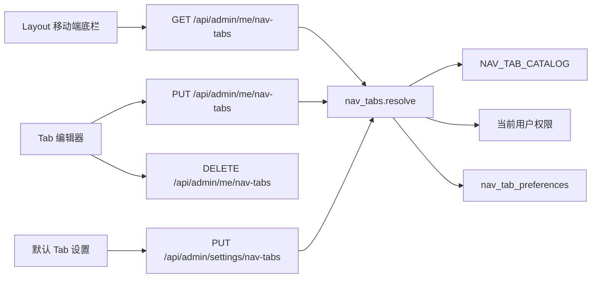

# 自定义底部 Tab

Feature Name: custom-bottom-tabs
Updated: 2026-11-01

## Description

为每个登录用户保存一份底部 Tab 配置，并由管理员维护全站默认配置。底部 Tab 只在宽度小于 768px 的视口显示。候选页面等于侧栏页面加 MCP 广场应用，最多 5 项。用户选择不受默认集合限制，但服务端会按该用户的查看权限过滤有效结果。

现有固定入口在 `frontend/src/components/nav.ts` 的 `TAB_LINKS`，渲染在 `frontend/src/components/Layout.tsx`。本设计把这份静态列表降级为内置默认，运行时改为读取服务端返回的有效路径。

## Architecture



读取和保存都经过同一个解析器。解析器先校验路径属于候选目录，再按当前用户权限生成有效列表。个人配置优先于默认配置；两者都缺失时使用内置默认。

## Components and Interfaces

### 候选目录

在 `backend/app/nav_tabs.py` 维护 `NAV_TAB_CATALOG`，路径与前端 `NAV_LINKS + PLAZA_APP_LINKS` 对齐：

- `path`: 页面路径，例如 `/`、`/mcp-plaza/keys`
- `label`: 默认展示名
- `perm`: 进入页面所需查看权限，缺省表示登录即可

内置默认路径：

1. `/`
2. `/accounts`
3. `/keys`
4. `/logs`
5. `/skills`

前端继续从 `nav.ts` 取图标和本地标签。保存时只提交路径，不提交标签或图标。

### 数据模型

新增 `NavTabPreference`，表名 `nav_tab_preferences`：

- `id`: 主键
- `scope`: `default` 或 `user`
- `admin_id`: 用户配置指向 `admins.id`；默认配置为空
- `paths_json`: JSON 字符串，保存有序路径数组
- `updated_at`

约束：

- `scope='default'` 只保留 `admin_id IS NULL` 的一行
- `scope='user'` 对 `admin_id` 唯一

`init_db` 继续通过 `Base.metadata.create_all` 建表。不需要为旧库补列。

### 接口

`GET /api/admin/me/nav-tabs`

返回：

- `catalog`: 当前用户有查看权限的候选页面
- `default_paths`: 管理员默认路径；无记录时为内置默认
- `custom_paths`: 个人路径；未设置时为 `null`
- `effective_paths`: 实际渲染路径
- `source`: `custom`、`default` 或 `builtin`
- `max_tabs`: `5`

`PUT /api/admin/me/nav-tabs`

请求体为 `{ "paths": string[] }`。服务端要求 1 到 5 个去重后的候选路径，且每个路径对当前用户可查看。成功后返回与 GET 相同的结构。

`DELETE /api/admin/me/nav-tabs`

删除当前用户的个人行，并返回回退后的配置。

`GET /api/admin/settings/nav-tabs`

登录用户可读，供编辑器展示当前默认值。

`PUT /api/admin/settings/nav-tabs`

要求 `nav_tabs:manage`。请求体同样为 `{ "paths": string[] }`。默认配置只校验路径属于候选目录，不按某个用户的权限裁剪，因为不同用户权限不同。读取时再按各用户权限过滤。

### 权限

在 `permissions.py` 增加：

- `nav_tabs:manage`: 设置默认底部 Tab

用户读写自己的 `/api/admin/me/nav-tabs` 只要求登录，不新增页面权限。`permission_guard.py` 将 `PUT /api/admin/settings/nav-tabs` 显式映射到 `nav_tabs:manage`；对应 GET 使用登录可读的放行策略，避免普通用户无法获知默认值。

### 前端

`Layout` 用 `useQuery` 读取 `/api/admin/me/nav-tabs`。在接口返回前，移动端先用内置 `TAB_LINKS` 过滤结果占位，返回后替换为 `effective_paths`。

Tab 编辑器放在现有账号设置弹层中：

- 候选区列出 `catalog`
- 已选区支持上移、下移、移除
- 达到 5 项后禁止继续添加
- 「保存」调用 PUT
- 「恢复默认」调用 DELETE
- 持有 `nav_tabs:manage` 的用户额外看到「保存为全站默认」

底部 Tab 的现有样式保持不变：固定底栏、高度 56px、安全区、`md:hidden`。标签继续使用路径对应的短标签；广场应用沿用现有标签。

## Data Models

```json
{
  "catalog": [
    {"path": "/", "label": "概览", "perm": "dashboard:view"}
  ],
  "default_paths": ["/", "/accounts", "/keys", "/logs", "/skills"],
  "custom_paths": ["/mcp-plaza", "/logs"],
  "effective_paths": ["/mcp-plaza", "/logs"],
  "source": "custom",
  "max_tabs": 5
}
```

路径数组在入库前执行：

1. 去除首尾空白
2. 删除空字符串和重复项，保留第一次出现的位置
3. 拒绝未知路径
4. 个人配置再拒绝当前用户无查看权限的路径
5. 拒绝长度为 0 或大于 5 的结果

## Correctness Properties

- 同一用户最多存在一行 `scope='user'` 配置。
- 全站最多存在一行 `scope='default'` 配置。
- `effective_paths` 是 `custom_paths`、`default_paths` 或内置默认三者之一的权限过滤结果。
- 管理员更新默认配置不修改任何 `scope='user'` 行。
- 用户恢复默认后，`custom_paths` 为 `null`，`source` 变为 `default` 或 `builtin`。
- 有效路径长度始终为 0 到 5。

## Error Handling

- 路径非法、为空、重复或超过 5 项：返回 400，消息说明具体原因。
- 未登录：沿用现有 401。
- 修改默认配置但缺少 `nav_tabs:manage`：返回 403。
- 前端保存失败时保留编辑器内容，并展示接口返回的 `detail`。
- 前端读取失败时继续显示内置默认中的有权限入口，不阻塞页面主体。

## Test Strategy

后端测试覆盖：

- 无个人配置、无默认配置时返回内置默认
- 用户保存后优先返回个人配置
- 用户恢复默认后回退
- 拒绝未知路径、无权限路径、空列表和 6 项列表
- 管理员更新默认值不影响已有个人配置
- 无 `nav_tabs:manage` 时修改默认配置返回 403

前端用现有组件测试或页面测试覆盖：

- 小于 768px 时按返回顺序渲染
- 大于或等于 768px 时不渲染底栏
- 编辑器最多选择 5 项，并按顺序提交路径

## References

[^1]: (Filename#L128) - [现有固定底部 Tab](frontend/src/components/nav.ts)
[^2]: (Filename#L559) - [移动端底栏渲染](frontend/src/components/Layout.tsx)
[^3]: (Filename#L64) - [当前用户接口](backend/app/routers/admin_auth.py)
