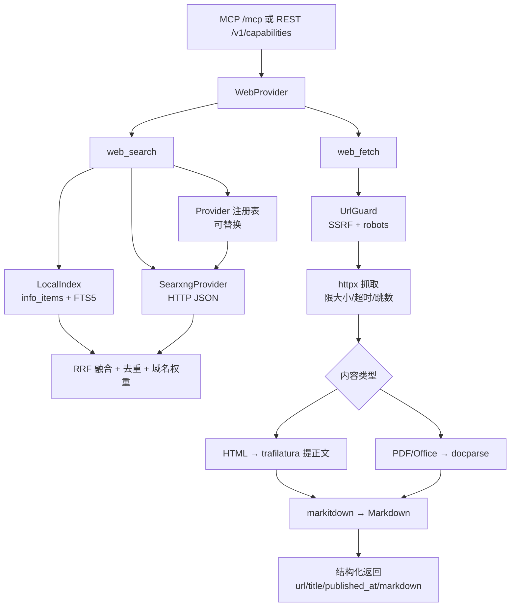

# 联网搜索与网页解析 技术方案

Feature Name: 2026-11-02-web-search-fetch
Updated: 2026-11-02

## 背景

MCP 广场已具备 `knowledge`、`docparse`、`site`、`douyin`、`info`、`generation`、`reference`、`diagram` 八类能力（`backend/app/capabilities/registry.py:80`），缺少「发现网页」和「读取任意网页」这两步。Agent 在真实任务里调用频率最高的正是这两步。

### 可复用资产

| 能力 | 位置 | 复用方式 |
|------|------|----------|
| HTML/PDF/Office → Markdown | `backend/app/capabilities/docparse/convert.py:16` | 直接调用 `convert_bytes` |
| SSRF 防护 | `backend/app/info/urlguard.py:57` | 复用 `assert_safe_url`，补充逐跳重定向校验 |
| HTTP 客户端 | `backend/app/offline/http.py:19` | 复用 `make_client`、UA、超时约定 |
| HTML 白名单清洗 | `backend/app/info/sanitize.py:16` | 正文降级路径复用 |
| FTS5 + BM25 | `backend/app/services/knowledge/fts.py:40` | 私域索引照搬写法 |
| RRF 融合 | `backend/app/services/knowledge/search.py:75` | 多 provider 结果融合 |
| 能力注册 | `backend/app/capabilities/registry.py:11` | 新增 `WebProvider` 一行注册 |
| Key 与白名单 | `backend/app/models.py:621` | 沿用 `McpKey` + `McpKeyCapability` |

### 缺口

- 缺正文提取库。当前只有 `bs4`、`lxml`，`trafilatura` / `readability` 均未安装。
- `info_items` 没有 FTS 索引，无法直接检索。
- 没有外部搜索 provider 的抽象层。

## Architecture



## 目录结构

```
backend/app/capabilities/web/
├── __init__.py
├── provider.py        # CapabilitySpec + 两个 McpToolDef + dispatch
├── errors.py          # WebError
├── fetch.py           # 抓取 + 正文提取 + Markdown
├── robots.py          # robots.txt 缓存与判定
├── index.py           # info_items 的 FTS5 建表/写入/检索
├── search.py          # 统一搜索编排：local + provider + RRF
├── ranking.py         # 去重、域名权重、时间衰减
└── providers/
    ├── base.py        # SearchProvider 协议与 SearchResult
    ├── searxng.py     # 自托管 SearXNG JSON 接口
    └── none.py        # disabled 实现
```

## 数据模型

### info_items 全文索引

不改 `InfoItem` 表结构，新增 FTS5 影子表，与 `knowledge_chunks_fts` 同模式：

```sql
CREATE VIRTUAL TABLE IF NOT EXISTS info_items_fts USING fts5(
    text, excerpt, title, item_id UNINDEXED,
    tokenize = 'unicode61'
);
```

维护方式：

- 采集入库时写入（`backend/app/info/items.py` 新增调用点）。
- 删除、隐藏时同步删除。
- 提供一次性回填命令，扫描 `info_items` 建索引。
- FTS5 自带 `bm25()` 排序，无需额外打分。

### 搜索缓存（可选）

外部 provider 结果按 `query + provider + 时间桶` 缓存到 SQLite，默认 TTL 10 分钟，避免同一查询反复打上游。

## 工具定义

### web_search

```json
{
  "name": "web_search",
  "description": "检索网页。默认先查本地资讯库，结果不足时补充联网搜索。返回标题、链接、摘要与来源。",
  "input_schema": {
    "type": "object",
    "properties": {
      "query": { "type": "string", "description": "查询词" },
      "top_k": { "type": "integer", "minimum": 1, "maximum": 20, "default": 8 },
      "time_range": { "type": "string", "enum": ["day", "week", "month", "year", "any"], "default": "any" },
      "site": { "type": "string", "description": "只在这些域名内检索，逗号分隔" },
      "scope": { "type": "string", "enum": ["auto", "local", "web"], "default": "auto" }
    },
    "required": ["query"]
  },
  "returns": "results[]: {title, url, snippet, source, published_at, score, provider}；warnings[]: string"
}
```

`scope` 语义：

- `local`：只查 `info_items`。
- `web`：只查外部 provider。
- `auto`：先 local，命中数不足 `top_k` 时补 web，再 RRF 融合。

### web_fetch

```json
{
  "name": "web_fetch",
  "description": "抓取一个网页并提取正文，返回干净 Markdown。适用于文章、文档、博客；PDF 也支持。",
  "input_schema": {
    "type": "object",
    "properties": {
      "url": { "type": "string", "description": "http/https 链接" },
      "max_chars": { "type": "integer", "minimum": 1000, "maximum": 200000, "default": 40000 },
      "include_links": { "type": "boolean", "default": false }
    },
    "required": ["url"]
  },
  "returns": "url, final_url, title, published_at, markdown, truncated, extract_fallback, warnings[]"
}
```

## 抓取管线

```
assert_safe_url(url)
  → robots.txt 判定（UA 与抓取一致，结果缓存 1 小时）
  → httpx 流式 GET，手动逐跳处理 3xx，每跳重新做 SSRF 校验
  → 校验 content-type 与 content-length
  → HTML: trafilatura.extract → 失败则 sanitize + markitdown
  → PDF/Office: 交给 docparse.convert_bytes
  → 截断到 max_chars，返回
```

关键约束：

- 单次抓取上限默认 5MB，超时 20s，最多 5 跳。
- 重定向每跳都过 `urlguard`，防止 DNS rebinding 与跳转绕过。
- 只接受 `text/html`、`text/plain`、`application/pdf`、Office MIME；其余直接拒绝。
- 不执行 JavaScript，JS 渲染站点返回 `extract_fallback=true` 的空正文提示。

## 搜索编排

```python
async def search(query, top_k, time_range, site, scope, ctx):
    local = await local_index.search(...) if scope in ("auto", "local") else []
    if scope == "local" or len(local) >= top_k:
        return merge(local)
    external = await provider.search(...)  # 失败只记 warning
    return rrf_merge([local, external], top_k)
```

排序细则：

- URL 归一化后去重，保留分数更高的。
- 域名权重：`.gov`、`.edu`、官方文档域名加权，内容农场域名降权。
- 时间衰减：`published_at` 距今越近权重越高，`time_range` 为硬过滤。
- 私域结果在 `auto` 模式下整体加 `source_boost`，保证自有数据优先。

## 外部 provider 接入

`SearchProvider` 协议：

```python
class SearchProvider(Protocol):
    name: str
    async def search(self, query: str, *, top_k: int, time_range: str, site: str) -> list[SearchResult]: ...
```

### searxng

- 调用 `GET {base_url}/search?q=...&format=json&language=zh-CN&time_range=...`
- 需要 SearXNG 实例开启 `json` 输出格式。
- 超时 10s，失败返回空列表并写 `warnings`。
- 部署形态：docker-compose 增加独立 sidecar，网关只通过 HTTP 调用，不 fork 其源码（AGPL 边界）。

### 配置项

| 变量 | 默认 | 说明 |
|------|------|------|
| `WEB_ENABLED` | `true` | 是否注册 web 能力 |
| `WEB_SEARCH_PROVIDER` | `none` | `none` / `searxng` |
| `WEB_SEARXNG_BASE_URL` | 空 | 例：`http://searxng:8080` |
| `WEB_SEARCH_TIMEOUT_SECONDS` | `10` | 外部搜索超时 |
| `WEB_SEARCH_CACHE_TTL_SECONDS` | `600` | 搜索结果缓存 |
| `WEB_FETCH_TIMEOUT_SECONDS` | `20` | 抓取超时 |
| `WEB_FETCH_MAX_BYTES` | `5242880` | 单次抓取上限 |
| `WEB_FETCH_MAX_REDIRECTS` | `5` | 最大跳数 |
| `WEB_FETCH_MAX_CHARS` | `40000` | 返回正文上限 |
| `WEB_ROBOTS_ENABLED` | `true` | 是否遵守 robots.txt |
| `WEB_USER_AGENT` | 复用 `info_user_agent` | 抓取 UA |
| `WEB_LOCAL_SEARCH_BOOST` | `0.15` | 私域结果加权 |

## 权限与计费

- 复用 `McpKeyCapability` 白名单，`capability_id = "web"`。
- 每次调用写 `mcp_call_logs`，记录 `operation`、耗时、结果数、provider。
- 外部搜索可计入 Key 的调用配额，避免被刷。

## 实施计划

### 阶段一：网页解析（预计 1-2 天）

1. 新增 `web` capability 骨架与注册（`registry.py` 加一行）。
2. 实现 `robots.py`、`fetch.py`，接入 `urlguard` 与 docparse。
3. 引入 `trafilatura` 依赖，处理提取失败降级。
4. 补齐 `web_fetch` 的 SSRF、大小、重定向、content-type 测试。

### 阶段二：私域搜索（预计 2-3 天）

1. 建 `info_items_fts` 与回填脚本。
2. 在采集入库、删除、隐藏处维护索引。
3. 实现 `index.py` 检索与时间过滤。
4. 接入 `web_search` 的 `scope=local`。

### 阶段三：外部 provider（预计 2-3 天）

1. 定义 `SearchProvider` 协议与 `SearchResult`。
2. 实现 `none` 与 `searxng`。
3. 实现 `search.py` 编排、`ranking.py` 去重与加权。
4. docker-compose 增加 SearXNG sidecar 示例与环境变量。
5. 补超时、降级、缓存测试。

### 阶段四：联调与文档（预计 1 天）

1. MCP 工具自测与 `catalog_payload` 校验。
2. 管理端广场卡片、接入说明、Key 白名单页面。
3. README 与接入文档补充。

## 风险与取舍

| 风险 | 影响 | 应对 |
|------|------|------|
| SearXNG 上游改版导致解析失效 | 全网结果为空 | provider 可切换为 `none`，私域搜索不受影响 |
| 上游 IP 限流/验证码 | 结果质量下降 | 支持代理池，缓存结果，限制频率 |
| trafilatura 对部分站点提取为空 | 正文缺失 | 降级到整页清洗 + markitdown，并标记 `extract_fallback` |
| JS 渲染页面无法读取 | 部分站点不可用 | 明确返回提示；后续可评估无头浏览器 |
| robots.txt 判定增加延迟 | 抓取变慢 | 结果本地缓存 1 小时 |
| AGPL 传染 | 合规风险 | SearXNG 独立进程部署，仅 HTTP 调用，不改源码 |
| 全网爬虫的合规与资源成本 | 不可控 | 明确列为非目标，不实现 |

## 待确认

1. 私域搜索的数据源范围：仅 `info_items`，还是同时纳入 `knowledge` 知识库？建议先做 `info_items`，知识库已有独立工具。
2. `web_search` 默认 `scope` 用 `auto`（本地优先）还是 `web`（全网优先）？建议 `auto`。
3. 是否需要在管理端提供 SearXNG 引擎开关与权重配置？建议本轮只读环境变量，后续再做页面。
4. 外部搜索是否计入 Key 配额？建议计入，按次数计。
