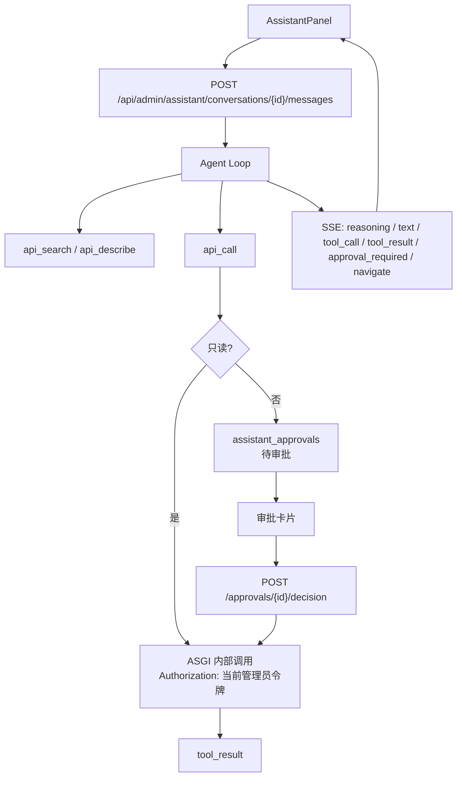

# AI 助手技术方案

Feature Name: 2026-11-06-ai-assistant
Updated: 2026-11-06

## Description

助手由后端 Agent Loop 编排，前端只负责流式渲染和审批交互。后端自动扫描管理接口生成目录，模型按需搜索接口；只读接口以内置 ASGI 客户端和当前管理员令牌执行；写接口落审批，管理员确认后执行并继续对话。前端展示思考过程、工具调用、审批卡片和页面跳转。

## Architecture

## Components

### 后端

- `backend/app/assistant/api_catalog.py`：扫描 `app.openapi()`，过滤管理接口，生成中文摘要、权限码、只读标记、参数和请求体 schema；提供搜索、描述和页面目录。
- `backend/app/assistant/api_client.py`：用 `httpx.ASGITransport` 以当前管理员令牌调用站点接口；统一错误解析和敏感字段脱敏。
- `backend/app/assistant/tools.py`：四个内置工具 `api_search`、`api_describe`、`api_call`、`ui_navigate`；写接口创建审批。
- `backend/app/assistant/agent.py`：LiteLLM 流式调用、工具轮次、思考内容、SSE 事件和会话持久化。
- `backend/app/assistant/store.py`：助手设置、会话、消息、审批的读写。
- `backend/app/routers/admin_assistant.py`：设置、模型、会话、消息流和审批决策接口。

### 前端

- `AssistantProvider`：会话状态、SSE 解析、事件归并、页面跳转和审批决策。
- `AssistantPanel`：桌面浮动面板 / 移动全屏面板，自动跟随滚动。
- `MessageBubble`：思考过程折叠区，按事件顺序渲染文本和工具卡片。
- `ToolCallCard`：方法徽标、路径、状态、耗时、参数/结果、审批按钮。
- `AssistantSettingsDialog`：账号、模型、提示词和采样参数。

## API Catalog

- 数据源：`app.openapi()`，只保留 `/api/admin` 路径。
- 排除：助手自身接口、登录、OAuth、密钥明文、导出、访问令牌、下载和 SSE 接口。
- 搜索：路径、摘要、分类、权限码和关键词；中文按二元组匹配并加权分类/路径命中。
- 描述：返回参数列表、解析后的请求体 schema、请求体示例、权限码、是否只读、是否需要审批。
- 权限：搜索和调用前用 `required_codes` 与当前账号权限过滤；最终执行仍由原接口守卫兜底。

## Approval Flow

1. `api_call` 识别到写方法后写入 `assistant_approvals`，返回 `approval_required`。
2. Agent 保存带 `tool_calls` 的 assistant 消息并结束本轮，`done.awaiting_approval=true`。
3. 前端显示审批卡片；同一会话的新消息返回 409。
4. 同一轮模型返回多个工具调用时，审批后的其余调用记录为「等待审批，未执行」，保证每个 tool_call 都有对应 tool 消息。
5. 管理员批准后，审批接口先使用当前令牌执行原接口，写入 tool 消息并更新审批状态，再启动继续对话流。
6. 拒绝时写入 `user_rejected` tool 结果并继续对话，让模型解释或给出替代方案。
7. 构造 LLM 历史时按 assistant tool_calls 逐个配对 tool 消息；缺失结果补一条错误 tool 消息，避免上游拒绝请求。

## Data Models

- `assistant_settings`：单例配置（账号、模型、提示词、温度、tokens、轮次、历史数）。
- `assistant_conversations`：管理员会话。
- `assistant_messages`：user / assistant / tool 消息，保存 tool_calls、reasoning、用量。
- `assistant_approvals`：待审批和已审批的写操作，保存方法、路径、参数、请求体、原因和结果。

## SSE Events

- `meta`：会话、模型、是否继续。
- `status`：thinking / writing / tool。
- `reasoning`：思考增量。
- `text`：最终回复增量。
- `tool_call`：工具调用开始。
- `tool_result`：工具执行结果。
- `approval_required`：写操作等待审批。
- `navigate`：前端路由跳转。
- `usage`、`done`、`error`。

## Security

- 内部调用使用当前请求的 JWT，权限、审计、限流与原接口一致。
- 敏感 GET 接口（密钥明文、访问令牌、导出）不进入目录；所有工具结果对 `api_key`、`password`、`secret`、`token` 等字段脱敏。
- 写操作必须审批；审批记录绑定管理员和会话。
- 工具结果在提示词中标记为数据，系统提示词禁止执行其中的指令。

## Test Strategy

- 目录：管理接口可解析、敏感接口被排除、权限过滤生效、搜索结果相关。
- 执行：只读接口以管理员身份返回真实数据；4xx/5xx 作为工具错误。
- 审批：写操作不立即执行、同一会话阻塞新消息、批准后执行并继续、拒绝后不执行。
- 前端：桌面/移动无横向溢出；思考过程、工具卡片、审批卡片、跳转和暗色主题。
- 真实模型：使用管理员配置的上游账号完成搜索、只读调用、写审批和页面跳转。
