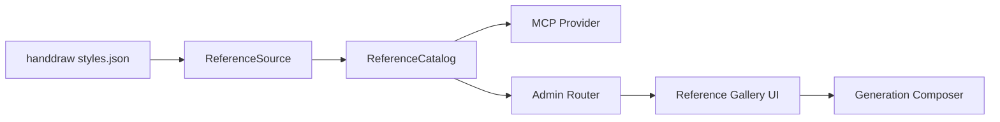

# MCP 手绘风格库设计

Feature Name: mcp-handdraw-style
Updated: 2026-11-07

## Description

在现有 `reference` 能力框架上新增 `handdraw` 规格，复用统一的检索、代理、权限和图片生成参考图链路。上游使用 `philipxiaoxi/handraw-style` 的 `styles.json` 与 `images/individual/**` 资源。

## Architecture



## Components and Interfaces

- `backend/app/capabilities/reference/specs.py`
  - 新增 `HANDDRAW` 规格，定义字段映射、来源地址、署名与提示词前缀。
- `backend/app/capabilities/reference/source.py`
  - 支持 per-spec 来源地址。
  - 将 `styles.json` 的上游结构转换为通用参考图字段。
- `backend/app/capabilities/reference/images.py`
  - 支持按 spec 传入上游 base，用于图片代理与白名单校验。
- `backend/app/routers/admin_references.py`
  - 注册 `handdraws` 管理路由。
- `frontend/src/components/ReferenceGallery.tsx`
  - 新增 `handdraw` 类型与筛选 UI。
- `frontend/src/pages/McpReference.tsx`
  - 新增页面标题。
- `frontend/src/pages/ImageGen.tsx` / `GenerationComposer.tsx`
  - 参考图选择器暴露手绘风格库。

## Data Models

上游 `styles.json` 记录转换为：

```text
id = number
title = generation_name
group = family
category = reference
detail = number
keywords = traits
image = images/individual/{family_code}/{number}.webp
```

## Correctness Properties

- 保留作者与原仓库署名。
- 图片代理仅允许配置的上游域名。
- 检索结果必须携带示例图直链与核心特征提示词。
- 权限缺失时接口返回 403。

## Error Handling

- 上游索引拉取失败：返回 502，并标记 `stale`。
- 图片下载失败：返回 502。
- 权限不足：返回 403。

## Test Strategy

- 后端单测覆盖 `handdraw_search`、提示词、图片代理、权限与 MCP Key 绑定。
- 前端构建与类型检查通过。
- 本地手动验证 MCP 广场卡片、参考图选择器与图片生成页入口。

## References

[^1]: (Repository) philipxiaoxi/handraw-style
