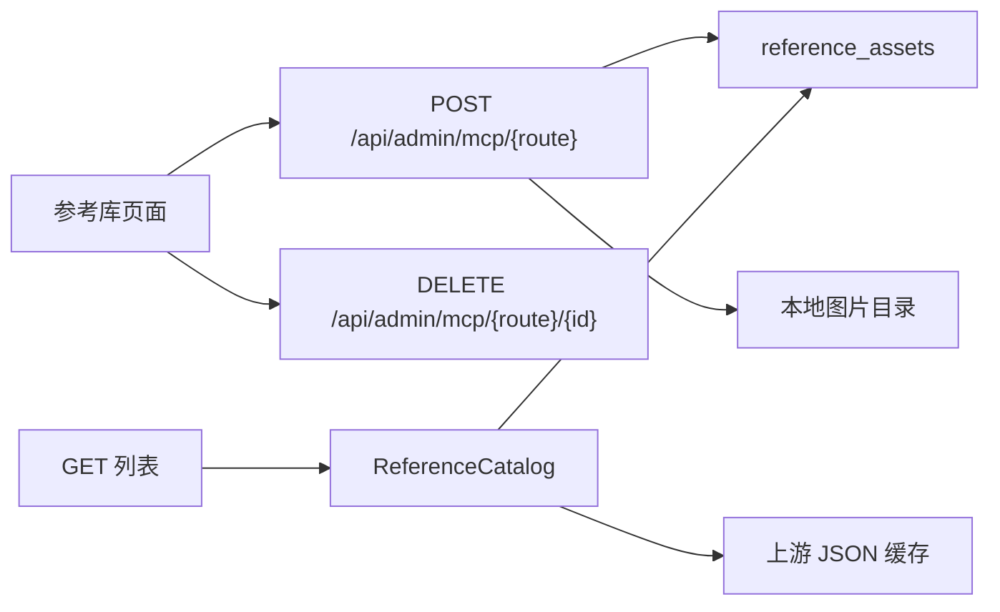

# 参考库添加本地参考

Feature Name: reference-library-contribute
Updated: 2026-11-02

## Description

为人像、姿势、服装三个参考库增加本地入库能力。本地记录存入数据库，图片存入站点文件目录。查询时合并本地记录与上游缓存，上游刷新只更新缓存。

## Architecture

添加和删除沿用三个参考库现有路由前缀：`/api/admin/mcp/portraits`、`/poses`、`/costumes`。权限分别复用 `mcp_portraits:sync`、`mcp_poses:sync`、`mcp_costumes:sync`。

## Components and Interfaces

- `ReferenceAsset` 保存本地记录。服务层负责校验、写文件、生成缩略图和删除文件。
- 创建接口使用 `multipart/form-data`，字段包括 `file`、`title`、`group`、`category`、`detail`、`tags`、`prompt`、`adult`。
- 列表、详情、随机和 meta 先读取本地记录，再读取 `ReferenceSource` 的上游记录。合并后的本地记录使用 `local:{id}` 标识。
- 本地图片通过现有静态文件目录提供 URL，响应中的 `source` 为 `local` 或 `upstream`。
- `ReferenceGallery` 增加添加对话框。本地卡片显示来源标记和删除按钮。分组和分类提供已有值选择，同时允许输入新值。
- 18+ 判断同时尊重显式 `adult` 标记和三个库现有的分组、分类规则。

## Data Models

`reference_assets` 表：

- `id`: Integer，主键。
- `kind`: String(16)，取值 `portrait`、`pose`、`costume`。
- `title`: String(200)。
- `group_name`、`category`、`detail`: String(120)，默认为空。
- `tags_json`: Text，保存字符串数组。
- `prompt`: Text。
- `adult`: Boolean，默认 false。
- `image_path`、`thumb_path`: String(500)。
- `width`、`height`: Integer，默认 0。
- `created_by`: Integer，可空。
- `created_at`、`updated_at`: DateTime。

图片目录为 `{database_dir}/references/{kind}/{id}`。缩略图由原图生成，最长边限制为 480 像素。

## Correctness Properties

- 上游刷新不修改 `reference_assets` 和本地图片目录。
- 本地标识只匹配 `local:{id}`，不能删除上游标识。
- 关闭 18+ 时，显式 18+ 和规则命中的本地记录都不出现在列表、详情和随机结果中。
- 同一查询条件下，本地记录稳定排在上游记录之前，并参与统一分页。
- 创建失败时不保留孤立图片文件。

## Error Handling

- 缺少图片、标题为空、格式不支持或文件超过 15 MB 返回 400。
- 无管理权限返回 403。
- 删除不存在的本地标识或不属于本库的记录返回 404。
- 文件写入失败时回滚数据库记录并清理已写入文件。
- 缩略图生成失败时保留原图路径作为缩略图路径，并记录警告。

## Test Strategy

- 服务测试覆盖三个 kind 的创建、字段校验、文件大小和清理。
- API 测试覆盖合并排序、筛选、18+ 隐藏、删除本地记录、拒绝删除上游记录。
- 刷新测试先创建本地记录，再执行上游 refresh，确认本地记录保持可见。
- 前端验证添加对话框、来源标记、删除确认，以及 PC 与移动端布局。

## References

[^1]: (Filename#L17) - 现有只读路由 `backend/app/routers/admin_references.py`
[^2]: (Filename#L203) - 参考库权限 `backend/app/permissions.py`
