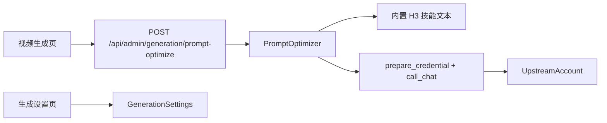

# 视频提示词一键优化

Feature Name: video-prompt-optimize
Updated: 2026-11-02

## Description

在视频生成提示词区域增加带图标和跑马灯灯效的优化按钮。后端读取随版本发布的 H3 提示词技能，使用站点已有上游账号完成一次非流式文本补全，校验结果后返回给前端替换输入框。

## Architecture

技能来源固定为 `https://github.com/MiniMax-AI/MiniMax-H3/tree/main/skills/h3-prompt-writing` 的 `SKILL.md` 与 `references/base-en.txt`。发布时把这两份文本放入后端资源目录。请求路径不访问 GitHub。

## Components and Interfaces

- `GenerationComposer` 仅在 `kind=video` 且配置启用时渲染按钮。按钮使用 `Sparkles` 图标，边框使用 CSS 跑马灯动画。请求期间禁用按钮。
- `POST /api/admin/generation/prompt-optimize` 接收 `prompt`、`duration_seconds`、`image_count` 和可选 `mode`。成功返回 `{prompt, mode, model}`。
- `PromptOptimizer` 选择模式：0 张图为 `t2va`，1 张图为 `i2va`，2 张及以上为 `fl2va`，显式 `l2va` 优先。它把技能文本、用户意图、时长和模式约束组成系统提示。
- 设置读写扩展现有生成设置接口，增加 `prompt_optimize_enabled`、`prompt_optimize_account_id`、`prompt_optimize_model`。
- 账号候选复用 `GET /api/admin/voice/polish-accounts` 的账号与模型列表语义，避免新增第二套账号目录。

## Data Models

`generation_settings` 增加：

- `prompt_optimize_enabled`: Boolean，默认 false。
- `prompt_optimize_account_id`: Integer，可空。
- `prompt_optimize_model`: String(128)，默认空字符串。

优化请求和结果不单独入库。生成任务仍保存最终提交的提示词。

## Correctness Properties

- 参考图数量与模式映射保持稳定：0 对应 `t2va`，1 对应 `i2va`，大于 1 对应 `fl2va`。
- `i2va`、`fl2va`、`l2va` 的结果以技能规定的对齐指令开头。
- 所有结果按顺序包含 `integrated_multimodal_description`、`overall_soundscape`、`non_diegetic_music`。
- 优化失败不会写入输入框。
- 上游密钥只存在于既有账号存储，接口响应不返回密钥。

## Error Handling

- 空提示词返回 400。
- 功能关闭、账号缺失、账号不可用或模型为空返回 409。
- 上游超时、认证失败或空返回返回 502，并保留安全的错误摘要。
- 结构校验失败返回 502，前端保留原文。
- 单次调用超时 60 秒，前端按钮在返回前保持加载状态。

## Test Strategy

- 单元测试覆盖模式选择、技能资源读取、字段顺序校验和超长拒绝。
- API 测试覆盖未配置、成功替换、上游失败和权限拒绝。
- 前端测试覆盖视频页按钮渲染、加载态、成功覆盖和失败保留。
- 用假的 `call_chat` 返回样例提示词，测试不访问真实上游。

## References

[^1]: (Website) - [H3 Prompt Writing](https://github.com/MiniMax-AI/MiniMax-H3/tree/main/skills/h3-prompt-writing)
[^2]: (Filename#L142) - 上游调用参考 `backend/app/services/voice_polish.py`
